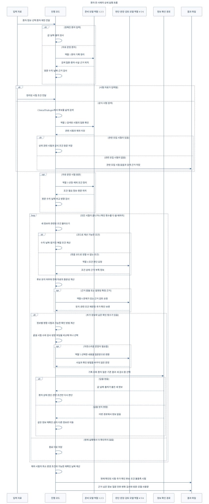

# ClarifyTrial 프로그램 설계

기준일: 2026-08-30

ClarifyTrial의 실행 순서와 종료 조건은 코드가 관리한다. 수치, 날짜와 조건 관계가
정리된 JSON을 입력하면 외부 언어모델을 부르지 않는다. 자유 문장을 읽거나 코드로 뜻을
정하기 어려운 조건이 있을 때만 여섯 역할 가운데 필요한 역할을 사용한다.

## 1. 코드와 언어모델의 경계

| 코드가 결정하는 일 | 언어모델이 맡을 수 있는 일 |
|---|---|
| 모집 상태 확인과 후보 시험 검색 | 자유 문장 환자 기록을 정해진 입력 형식으로 정리 |
| 검색 순위와 판정할 시험 수 결정 | 검색된 시험이 환자의 질환과 실제로 관련 있는지 확인 |
| 수치, 날짜, 단위와 논리 관계 계산 | 자유 문장 시험 조건을 계산 가능한 항목으로 정리 |
| 후보 유지 여부와 현재 확인 상태 집계 | 코드로 뜻을 정할 수 없는 조건 판단 |
| 다음에 확인할 정보와 허용되는 방법 선택 | 코드가 고른 확인 내용을 자연스러운 질문으로 작성 |
| 환자 제한 적용과 종료 결정 | 실제로 충돌하는 근거의 의미 검토 |
| 새 정보와 관련된 조건만 다시 판단 |  |
| 결과, 근거, 사용량과 실행 과정 저장 |  |

언어모델은 코드가 고른 정보, 확인 방법, 수치 계산이나 종료 규칙을 바꿀 수 없다. 모델
출력은 이름이 정해진 칸이 있는 JSON으로 받고, 식별자가 없거나 입력 범위를 벗어나면
사용하지 않는다.

## 2. 실제 모델 역할 수

| 번호 | 역할 | 언제 부르는가 | 최대 범위 |
|---:|---|---|---|
| 1 | 환자 기록 정리 | 환자 정보가 자유 문장일 때 | 환자 한 명당 준비 단계 1회 |
| 2 | 검색된 시험의 질환 확인 | 공식 검색이 넓게 찾은 시험이 환자 질환과 같은 대상인지 확인할 때 | 검색 후보를 한 묶음으로 처리 |
| 3 | 시험 조건 정리 | 새 시험 조건이 자유 문장일 때 | 시험 한 건당 준비 단계 1회, 이후 저장해 재사용 |
| 4 | 조건 판단 | 코드로 계산할 수 없는 조건이 있을 때 | 해당 시험의 관련 조건을 묶어서 처리 |
| 5 | 질문 문장 작성 | 사람이 읽을 자연스러운 질문이 필요할 때 | 코드가 고른 사실과 방법을 문장으로만 변환 |
| 6 | 근거 충돌 검토 | 서로 충돌하는 환자 근거나 잘못된 근거가 남았을 때 | 사례마다 필요한 부분만 선택적으로 호출 |

표의 여섯 역할을 위해 모델 여섯 개를 계속 띄워 두지는 않는다. 같은 모델을 역할별로
다른 입력 형식과 지시문으로 부를 수 있으며, 구조화 JSON만 다루는 실행에서는 모델
호출이 0회다.



[그림의 Mermaid 원본](diagrams/clarifytrial-performance-agent-architecture.mmd)

## 3. 입력

### 환자 상태

환자 사실마다 다음 항목을 저장한다.

| 항목 | 예 |
|---|---|
| 사실 이름 | 당화혈색소 |
| 값과 단위 | 7.2% |
| 측정 날짜 | 2026-08-24 |
| 자료 출처 | 검사 결과, 진료 기록, 환자 답변, 공식 확인 |
| 확인 상태 | 원문에 있음, 추정, 충돌, 확인 대기 |
| 근거 위치 | 입력 파일의 문장 또는 항목 번호 |

모든 단계가 같은 환자 상태표를 읽는다. 모델 대화 기록을 환자 상태 저장소로 사용하지
않는다. 새 정보가 들어오면 값, 날짜, 출처와 확인 상태를 함께 추가한다.

### 임상시험 조건

시험 조건은 선정 조건과 제외 조건을 나누고 다음 항목을 보존한다.

- 원문과 원문 위치
- 필요한 환자 사실
- 값, 단위, 비교 방향과 유효 기간
- `모두`, `하나 이상`, `일정 개수 이상`, 부정과 예외 관계
- 환자 답변으로 확인 가능한지 여부
- 기존 기록이나 공식 결과가 필요한지 여부
- 코드로 계산 가능한지 여부

자유 문장 조건을 언어모델이 정리했을 때 코드는 원문에 실제로 있는 수치, 날짜, 비교
방향과 출처를 다시 확인한다. 띄어쓰기와 줄바꿈은 비교하지 않는다. 원문에 없는 수치나
날짜를 만들었거나 비교 방향을 바꿨으면 해당 결과를 거부한다.

ClinicalTrials.gov에서 받은 선정·제외 조건 전체 원문도 함께 저장한다. 조건별 원문
위치는 이 전체 원문 안의 글자 위치로 남겨, 나중에 같은 문장인지 다시 검사할 수 있다.

### 환자 상황과 실행 한도

다음 값은 선택 입력이다.

- 확인할 수 있는 정보의 최대 개수
- 시간 긴급성
- 이동과 피로 제한
- 직접 비용 제약
- 새 검사, 추가 방문, 침습 절차 허용 여부
- 이미 예정된 검사와 진료 일정
- 빠른 확인과 추가 부담 최소화 가운데 선호하는 방향

공식 대회 환자 파일은 `num`과 `title`을 그대로 읽는다. 위 선택값은 원본 파일에
추가하지 않고 환자 번호별 설정 JSON으로 따로 받는다. 설정이 없는 환자는 중립값을
사용하므로 같은 입력 형식을 유지할 수 있다.

입력이 없으면 모든 일반 확인 방법을 허용하는 중립 설정을 쓴다. 환자 상황은 참가 조건
자체를 바꾸지 않고 확인 순서와 방법에만 영향을 준다.

## 4. 한 사례의 실행 흐름



[그림의 Mermaid 원본](diagrams/clarifytrial-detailed-workflow.mmd)

### 4.1 입력 준비

정해진 형식의 JSON은 바로 읽는다. 자유 문장은 환자 기록 정리와 시험 조건 정리 역할을
거친다. 정리 결과의 수치, 날짜, 비교 방향과 근거 위치를 코드가 검사한 뒤에만 상태표와
조건표에 넣는다.

### 4.2 관련 시험 검색

일반 실행은 환자 기록에서 정리한 질환명을 ClinicalTrials.gov 공식 API의 질환 검색에
보낸다. 모집 중, 모집 예정, 초대 등록 중인 시험만 받고 제목, 등록 질환, 요약과 참가
조건 원문을 함께 가져온다. 최종 판정 수보다 넉넉하게 후보를 받은 뒤, 두 번째 모델
역할이 환자의 질환과 같은 대상인지 확인한다. 예를 들어 `영아 비후성 유문협착` 검색에
잡힌 `성인 악성 위출구폐쇄` 시험은 여기서 제거한다. 관련 시험 가운데 기존 검색 순위가
높은 시험만 정해진 수만큼 다음 단계로 넘긴다.

공식 API 검색 응답은 주소와 받은 시각을 붙여 저장하고 같은 검색에서 재사용한다. 검색
결과가 비면 무관한 시험을 억지로 채우지 않고 `관련 모집 시험 없음`으로 실행을 끝낸다.

고정된 연구 비교에서는 목적에 따라 검색기를 바꿀 수 있다. 작은 로컬 자료에는 BM25를,
TrialGPT 검색 재현에는 BM25와 MedCPT 순위 결합을 사용한다. 이 비교용 검색 결과를 공식
API 기본 실행의 성능으로 바꾸어 말하지 않는다. 검색은 넓게 후보를 찾는 단계이며, 최종
판단은 참가 조건 원문을 읽는 다음 단계에서 한다.

검색 점수, 처음 순위와 검색에 사용한 환자 정보는 저장한다. 질문 뒤 조건 판단이
바뀌어도 처음 검색 순위를 덮어쓰지 않는다.

### 4.3 조건별 판단

선정 조건은 다음 네 상태를 사용한다.

- 충족
- 불충족
- 자료 부족
- 해당 없음

제외 조건은 다음 네 상태를 사용한다.

- 제외 조건에 해당
- 제외 조건에 해당하지 않음
- 자료 부족
- 해당 없음

`assess_criteria_bundle`은 수치, 날짜, 예·아니오와 구조화된 복합 조건을 먼저 찾는다.
이 조건은 코드 계산 결과로 `CriterionAssessment`를 바로 만들며 조건 판단 모델에 보내지
않는다. 남은 자유 문장 조건만 조건 판단 역할에 보낸다. 기본 설정은 여러 시험에서 최대
40개 조건을 한 호출에 묶는다. 모델이 일부 조건을 빠뜨리면 빠진 항목만 다시 요청한다.

각 조건 결과에는 환자 근거, 시험 원문, 판단 시각과 아직 필요한 정보가 붙는다.

### 4.4 두 결과 계산

조건별 결과를 시험 단위로 합칠 때 두 결과를 따로 계산한다.

| 후보 유지 결과 | 현재 확인 결과 | 화면에 보이는 뜻 |
|---|---|---|
| 후보 유지 | 현재 확인 완료 | 이번 사전 검토 범위에서 현재 자료로 확인이 끝난 후보 |
| 후보 유지 | 추가 확인 필요 | 가능성은 남지만 자료가 더 필요한 후보 |
| 후보 제거 | 참가 조건 불충족 | 명확한 위반 근거가 있는 시험 |
| 판단 보류 | 판단 보류 | 근거나 조건 뜻의 충돌이 남은 시험 |

예를 들어 3개월 전 정상 혈액검사는 후보를 유지할 근거가 될 수 있다. 시험이 최근
14일 이내 결과를 요구하면 현재 확인은 끝나지 않는다.

### 4.5 다음 정보 선택

현재 확인이 끝나지 않은 시험에 필요한 사실을 모은다. 이미 확인했거나 현재 미확정인
시험·조건과 연결되지 않은 정보는 제외한다.

두 선택 방법을 구현해 비교했다.

1. **현재 영향 우선:** 지금 가장 많은 미완료 시험에 연결된 정보를 고른다.
2. **앞으로 확인할 정보 조합 계산:** 남은 확인 횟수 안에 사용할 수 있는 정보 조합을 만들고,
   더 많은 시험의 판단을 끝낼 조합을 고른다.

같은 수의 시험에 영향을 주면 더 많은 미해결 조건과 연결된 정보를 우선한다. 다시
같으면 환자에게 새로 생기는 부담이 낮은 확인 방법을 선택한다.

실제 실행은 `현재 영향 우선`을 기본값으로 쓴다. 공개 환자 자료와 정보 연결 구조를
확인 횟수 1회, 2회, 3회로 나누어 비교했을 때 이 규칙은 가장 넓게 연결된 정보만 보는
방법과 비슷한 수의 시험을 정리하면서 확인 부담은 더 낮았다. 남은 횟수를 모두
계산하는 방법은 구조에 따라 조금 더 많은 시험을 정리했지만 확인 부담이 커졌고, 공개
조건의 가능한 값 조합에서는 기본 규칙보다 낮았다. 복잡한 계산은 비교 실험용으로
남겨 두었다.

### 4.6 확인 방법 선택

같은 사실을 다음 방법으로 얻을 수 있다.

| 확인 방법 | 예 |
|---|---|
| 현재 병원 기록 | 이미 저장된 검사 결과와 진료 기록 |
| 외부 기관의 기존 기록 | 다른 병원에 있는 과거 결과 요청 |
| 환자 답변 | 복용약, 과거 수술, 생활 정보 |
| 기존 공식 결과 확인 | 이미 시행한 검사나 평가의 값과 날짜 확인 |
| 새 검사 또는 평가 | 새 혈액검사, 설문, 수행 상태 평가 |
| 의료진 판단 | 수치만으로 끝낼 수 없는 해석이나 승인 |

각 방법에는 예상 대기, 방문, 직접 비용, 신체·심리 부담, 의료 위험, 치료 방해와 새로
시행하는 일인지 여부를 따로 저장한다. 여러 부담을 하나의 점수로 숨기지 않는다.

선택 순서는 다음과 같다.

1. 현재 이용할 수 없거나 환자가 허용하지 않은 방법을 제외한다.
2. 더 많은 시험과 미해결 조건에 연결된 정보를 먼저 고른다.
3. 영향 범위가 같으면 환자가 입력한 시간 긴급성, 이동, 비용과 절차 부담을 비교한다.
4. 부담을 줄이는 설정에서는 기존 자료를, 시간이 급한 설정에서는 더 빠른 새 검사를
   고를 수 있다.
5. 새 검사, 침습 절차 또는 치료 변경은 자동으로 실행하지 않고 선택 대기로 남긴다.

질문 문장 작성 역할은 여기서 코드가 고른 사실과 방법을 사람이 읽기 쉬운 문장으로만
바꾼다. 다른 사실로 질문을 바꾸면 실행을 중단한다.

### 4.7 답변과 재판정

실험에서는 가상 환자의 전체 상태에 미리 저장한 답만 반환한다. 답이 없는 경우에는
새 사실을 만들지 않고 `정보를 얻지 못함`으로 기록한다.

답을 받으면 다음 순서로 처리한다.

1. 값, 날짜, 출처와 근거 위치를 환자 상태표에 추가한다.
2. 새 사실과 연결된 조건만 다시 계산한다.
3. 시험의 후보 유지 결과와 현재 확인 결과를 갱신한다.
4. 남은 시험과 정보를 기준으로 다음 확인을 다시 고른다.

답을 얻지 못한 정보는 같은 실행에서 다시 고르지 않는다.

### 4.8 근거 충돌 검토

별도 검토 역할은 다음 경우에만 부른다.

- 코드로 계산할 수 없는 중요 조건의 뜻이 하나로 정리되지 않음
- 서로 다른 환자 자료가 실제로 충돌함
- 참가 가능 또는 참가 불가능 확정에 사용한 근거가 비어 있음

구조화된 수치·날짜·예·아니오 조건은 앞 단계에서 코드 판정이 끝나므로 검토 역할에
보내지 않는다. 자유 문장 조건에서 환자 근거가 서로 충돌하거나 확정 근거가 비어 있을
때만 검토한다. 모델이 입력에 없는 조건 또는 환자 근거 식별자를 만들면 검토 단계로
보내지 않고 해당 호출을 오류로 끝낸다. 설명이 짧거나 정보가 부족한 사례는 같은 모델에
되묻지 않고, 필요한 내용을 환자에게 묻거나 기존 기록을 확인하는 단계로 보낸다.

검토 결과는 그대로 유지, 관련 조건 다시 판단, 추가 정보 확인 또는 판단 보류 가운데
하나다. 역할끼리 자유 토론해 다수결로 결론을 만들지 않는다.

### 4.9 종료와 결과

실행은 다음 상태 가운데 하나로 끝난다.

- 모든 후보 시험의 현재 판단이 끝남
- 더 확인할 정보가 없음
- 확인 횟수를 모두 사용함
- 환자 또는 의료진의 선택을 기다림
- 이번 실행에서 정보를 얻을 수 없음
- 근거 충돌이 남아 판단을 보류함

최종 결과에는 두 목록을 함께 만든다.

1. **이번 사전 검토 범위에서 현재 자료로 확인이 끝난 시험**
2. **가능성을 넓게 보아 계속 확인할 시험**

각 시험에는 현재 위치의 이유, 처음 검색 순위, 조건별 근거, 남은 정보, 다음 확인
방법과 질문 전후 변화가 붙는다. 조건 불충족 시험도 사라지지 않고 위반 근거와 함께
별도 목록에 남는다.

## 5. 실패와 재시도

| 문제 | 처리 |
|---|---|
| 모델 출력이 JSON 형식이나 약속한 칸과 맞지 않음 | 호출 오류로 기록하고 실행을 중단 |
| 시험 또는 조건 일부가 빠짐 | 빠진 식별자만 다시 요청 |
| 원문에 없는 수치·날짜를 모델이 만듦 | 결과 거부, 해당 입력을 판단 보류로 남김 |
| 확인 도구가 답을 주지 않음 | 같은 실행에서 그 정보를 반복하지 않고 다른 정보로 이동 |
| 새 검사나 의료진 승인이 필요함 | 자동 진행하지 않고 선택 대기 상태 저장 |
| 실행이 중단됨 | 입력과 설정이 같을 때 완료된 환자를 건너뛰고 이어서 실행 |

성공한 모델 호출에는 역할, 입력 식별자, 출력, 토큰, 실행 시간과 통신 재시도 횟수를
저장한다. 전체 실행이 실패하면 `execution-error.json`과 그때까지의 `trace.jsonl`을
남기고 정상 결과 파일은 만들지 않는다. 환자 상태와 실행 단계를 함께 기록해 한 결론이
만들어진 순서를 따라갈 수 있다.

## 6. 코드 위치

| 폴더 | 책임 |
|---|---|
| `src/clarifytrial/preparation/` | 공식 API·고정 자료 후보 검색, 환자 기록과 시험 조건 준비, 원문 경계 검사와 조건 저장 |
| `src/clarifytrial/retrieval/` | 같은 단어 검색, 의학적 의미 검색과 순위 결합 |
| `src/clarifytrial/agents/` | 역할별 모델 입력, 출력 형식과 호출 기록 |
| `src/clarifytrial/workflow/` | 조건 판단, 두 결과 집계, 답변 반영과 재판정 |
| `src/clarifytrial/interactive/` | 다음 정보 선택, 환자 제한과 확인 방법 |
| `src/clarifytrial/app/`, `src/clarifytrial/ui/` | 파일 입출력, 저장·재개와 터미널 화면 |
| `src/clarifytrial/reporting/` | 추천 목록, 변화 통계와 연구 보고서 |
| `tests/` | 조건 계산, 입력 경계와 전체 흐름 검사 |

## 7. 선행연구에서 가져온 부분

| 설계 요소 | 중심 근거 |
|---|---|
| 날짜와 출처가 붙은 하나의 환자 상태표 | PRomop |
| 같은 단어·의학적 의미 검색과 조건별 판단 | TrialGPT, TrialMatchAI |
| 답변 뒤 후보와 다음 질문 갱신 | DQueST, Yang, TrialTriage |
| 현재 정보가 충분한지 먼저 판단 | MediQ |
| 최종 판단과 모은 증거를 따로 평가 | EviMed |
| 여러 시험에 영향을 주는 질문 우선 | DQueST |
| 확인 비용과 부담 고려 | Fink 계열, 환자 참여 선호 연구 |
| 원문 근거와 충돌의 선택적 재검토 | TRIAGE |

질문 생성, 여러 모델 역할, 외부 문서 검색과 답변 뒤 재판정은 새 기여로 주장하지
않는다. 문헌별 상세 구조와 공개 코드는
[논문과 공개 코드 목록](CLARIFYTRIAL_AGENT_SOURCE_INDEX.md)에 있다.

## 8. 현재 기본값을 고른 근거

### 질문과 재판정이 만든 변화

공개 임상시험 50건의 조건 202개를 사용해 합성 환자 30명에게 같은 질환의 시험을 다섯
건씩 연결했다. 환자-시험 조합 150개 가운데 28개는 처음 자료만으로 상태가 정리돼 있었다. 나이,
임신·수유 여부와 활동성 중증 감염을 처음부터 제공하자 명확히 제외되는 시험 68건과
참가 가능 후보 32개가 추가로 정리됐다. 질문 전에 상태가 정해진 조합은 128개, 추가
정보가 남은 조합은 22개였다.

환자마다 한 번까지 확인하도록 하자 질문은 14번 나왔다. 답을 받은 뒤 14개 시험이
확인 완료로 바뀌었고 8개는 계속 확인 대기로 남았다. 이미 입력한 나이를 다시 묻거나
새 근거 없이 상태를 확정한 사례는 없었다. 이 결과는 질문 전후 상태 변화이며 실제
환자의 참가 판정 정확도를 뜻하지 않는다.

### 질문 순서와 정보 연결 모양

세 기본 정보를 제공한 평가에서 가능한 질문 순서를 모두 실행한 평균은 94.22%, 현재
규칙은 94.67%의 시험 상태가 합성 정답과 같았다. 차이는 0.44%포인트였고, 환자 30명
중 29명은 두 결과가 같았다.

질문 순서가 영향을 주는 조건은 별도 합성 구조에서 확인했다. 정보 연결 모양 9종을
각각 200개씩 만들고 확인 횟수 1회, 2회, 3회를 따로 실행했다. 각 실행은 1,800개 구조,
57,600개 정보 상태와 691,200회 선택 방법 계산으로 이루어졌다. 세 실행을 합치면 계산은
2,073,600회다. 주 해석은 확인 2·3회에서 단계별 무작위, 현재 영향 우선과 앞으로 확인할
정보 조합을 계산하는 방법을 함께 비교한 결과다. 모든 시험이 같은 한 정보에 묶인
구조에서는 현재 규칙이 단계별 무작위보다 19.03~30.09%포인트 높았고 조합 계산과는
같았다. 시험마다 필요한 정보가 따로인 구조에서는 세 방법의 차이가 없었다. 사슬
구조에서는 조합 계산이 현재 규칙보다 3.2~4.3%포인트 높았다. 확인 1회의 43.28%포인트
차이는 첫 선택의 즉각적인 효과를 분리한 보조 진단으로만 남긴다.

공개 환자의 기본 문진을 제공하면 질문 순서 차이가 거의 사라지고, 합성 구조에서는
정보 연결 모양에 따라 결과가 달라졌다. 앞으로 확인할 정보 조합을 계산한 방법은 사슬 구조에서
도움이 됐지만 전체 평균 차이는 2.0%포인트 안이었다. 기본 실행에는 지금 미확정인 시험
수, 연결된 조건 수와 확인 부담을 함께 보는 규칙을 둔다. 앞으로 확인할 정보 조합을 계산하는
방법은 연결이 복잡할 때 비교할 수 있도록 남겨 뒀다.

### 환자가 이용할 수 있는 확인 방법

같은 답을 얻는 기존 공식 결과와 새 검사를 함께 둔 실험에서 부담을 줄이거나 이동·비용이
제한된 설정은 기존 결과를 85회 모두 골랐다. 시간이 급한 설정은 새 검사를 85회 모두
골랐다. 확인할 정보와 최종 시험 상태는 40개 비교에서 그대로 유지됐다.

새 검사와 추가 방문을 허용하지 않은 80개 설정에서는 새 검사 제안이 21회에서 0회,
추가 방문 제안이 56회에서 0회로 줄었다. 설정마다 남은 확인 대기 시험은 평균 0.88건에서
1.24건으로 늘었고, 시험 다섯 건을 모두 정리한 설정은 42개에서 32개로 줄었다. 금지한
방법을 피하면서 일부 결론을 더 기다리게 되는 변화까지 함께 기록한다.

### 언어모델을 부르는 경계

기존 평가와 겹치지 않는 공개 시험 15건의 구조화 조건 53개를 합성 환자 25명과 연결한
75개 환자–시험 조합에서 코드만 사용한 실행과 두 모델 사용 방식은 같은 결과를 냈다.
외부 모델 호출은 각각 0회, 65회, 105회였다. 구조화 JSON은 코드로
처리하고 자유 문장이나 계산하기 어려운 조건에만 모델 역할을 부르는 현재 경계는 이
결과에서 정했다. 수치, 날짜, 논리, 다음 정보, 확인 방법과 종료는 코드가 결정한다.
모델 역할끼리 자유 토론하지 않으며, 근거가 실제로 충돌할 때만 검토 역할을 한 번 더
부른다.

이 경계를 실제 전체 화면 흐름 한 사례에도 같은 프롬프트로 적용했다. 구조화 조건을 조건 판단 모델에
보내던 실행은 조건 판단 3회와 질문 문장 작성 2회로 모두 5회 호출했고 72,659토큰을
사용했다. 구조화 조건을 코드에서 바로 끝내도록 바꾼 실행은 조건 판단 호출이 0회가
됐고, 질문 문장 작성 2회에 23,707토큰을 사용했다. 최종 시험 다섯 건의 상태와 확인한
정보 순서는 같았다. 한 합성 환자에서 역할 연결과 사용량이 줄어드는지 확인한 기록이며,
평균 속도나 전체 성능을 추정하는 값으로 사용하지 않는다.

## 9. 참가 조건에 걸린 시험을 다시 볼 순서

참가 조건에 걸린 시험도 숨기지 않는다. 어떤 조건에 걸렸는지, 현재 값이 기준에서
얼마나 벗어났는지, 나중에 다시 확인할 수 있는 조건인지 함께 보여 준다.

예를 들어 세 조건을 모두 만족해야 하는 시험에서 두 조건이 이미 맞고 혈색소 하나만
기준에 조금 못 미치면, 필요한 변화는 `혈색소 한 조건`이다. 둘 중 한 조건 묶음만
충족하면 되는 시험에서는 모든 위반 조건을 세지 않고 가장 적게 달라져도 참가 가능성이
생기는 조건 묶음을 찾는다.

```text
참가 조건에 걸린 시험
→ 선정·제외 조건의 모두/하나 이상 관계 확인
→ 참가 가능 상태가 되려면 달라져야 할 최소 조건 묶음 계산
→ 재검사 가능한 값, 시간 경과, 되돌릴 수 없는 이력, 의료 상태·절차로 구분
→ 다시 확인 가능 / 별도 판단 필요 / 현재 다시 확인할 방법 없음으로 표시
```

이 계산은 기존 판정을 뒤집지 않는다. 현재 참가 조건에 걸렸다는 사실과, 이후 다시
확인할 가치가 있다는 사실을 별도 칸에 함께 저장한다.

현재 결과에는 다음 두 계산이 들어간다.

1. 걸린 조건을 모두 나열하는 데서 끝내지 않고, 여러 참가 조건 묶음 가운데 달라져야 할
   최소 조건 묶음을 찾는다.
2. 시간 기준이 가리키는 사건과 날짜가 확인됐을 때, 남은 기간을 실제 달력 날짜로
   바꾼다.

조건은 다섯 종류로 나눈다.

| 종류 | 결과에 적는 뜻 |
|---|---|
| 재검사 가능한 값 | 나중에 같은 검사를 다시 할 수 있으나 좋아진다고 예측하지 않음 |
| 시간 경과 | 시간이 지나면 조건이 달라질 수 있음 |
| 되돌릴 수 없는 이력 | 현재 다시 확인할 방법이 없음 |
| 의료 상태 또는 절차 | 기록이나 의료진 판단이 있어야 다시 볼 수 있음 |
| 현재 구조로 구분하기 어려움 | 바뀔 수 있다고 단정하지 않음 |

예를 들어 34세 환자가 `5세 이상 15세 이하` 시험에 걸린 경우는 시간이 지나도 다시
들어갈 수 없으므로 `현재 다시 확인할 방법 없음`으로 표시한다. `마지막 치료 후 28일` 같은
조건은 마지막 치료 날짜가 확인된 경우에만 다시 확인할 날짜를 계산한다.

| 표시할 내용 | 계산 기준 |
|---|---|
| 달라져야 할 최소 조건 묶음 | 현재 조건 논리와 충분한 근거가 있는 위반 조건 |
| 수치 기준과의 차이 | 같은 단위와 같은 조건 안의 현재 값과 기준값 |
| 다시 확인 가능한 날짜 | 조건이 가리키는 사건과 날짜가 환자 기록에서 확인된 경우 |
| 확인 방법 | 기존 기록, 환자 답변, 예정된 검사, 새 검사 가운데 실제 사용할 수 있는 방법 |
| 계산할 수 없는 이유 | 사건 날짜 없음, 단위 불일치, 복잡한 예외, 미래 변화 근거 없음 |

다른 검사 종류의 차이를 한 숫자로 합치지 않는다. 헤모글로빈 1 g/dL 차이와 대기기간
7일을 같은 거리로 비교하지 않으며, 근거가 없는 미래 확률도 만들지 않는다.

미래 검사값이 좋아질 확률은 만들지 않는다. 서로 다른 검사 종류의 차이를 한 숫자로
합치지도 않는다. eICU 검사 변화로 학습한 미래 확률은 현재 기본 흐름에 포함하지 않는다.

## 10. 환자 제약 아래의 의사결정나무 후보 — 활성, 2026-10-22

기본 실행과 분리된 연구용 `interactive/acquisition_planner.py`를 추가했다. 기존
`exact_policy.py`의 시나리오 기반 판정·답변 분기를 재사용한다. 새로 선택할 수 있는
정보와 총 방문 한도를 탐색 상태에 반영하되, 확인 불가능한 정보 자체를 가능한 환자
상태에서 지우지 않는다. 실패한 확인도 남은 행동 횟수에서 차감한다.

입력은 공개 시험 조건·시작 환자 근거·현재까지 공개된 답·개발군에서 고정한 가능한
답 분포·확인 경로·환자 제한이다. 실제 숨긴 답은 선택기에 전달하지 않는다. 적격과
부적격 양쪽을 포함한 현재 상태와 전체 시나리오 상태의 일치를 목적함수로 계산한다.
이는 개발 분포 아래의 기대값이며 환자의 임상적 참가 가능 확률이 아니다.

값이 달라도 모든 관련 객관적 조건의 결과가 같으면 같은 계획 상태로 묶고 확률을
합한다. 수치 조건 실험의 기대값을 유지하면서 중복 계산을 줄인다. 이 축약은 자유
문장·사실 사이의 수치 관계로 일반화하지 않는다. 연구 후보는 정보 6개·시나리오
4,096개·남은 확인 3회 이내로 제한하고, 범위를 넘으면 오류로 명시한다.

총 방문 한도가 있으면 정보별 최소 방문 수를 계획에 차감하고 실제 경로도 그 방문
수와 맞게 고른다. 검사 여러 개를 한 병원 방문으로 합치는 효과는 현재 모델에 없다.
그 밖의 알려진 비용·위험 제한을 먼저 적용하고, 제한을 판별할 부담값이 없으면 공짜로
간주하지 않는다. 환자·의료진의 승인 대기 표시는 기존 경로 선택기를 따른다.

사후 채점은 `interactive/acquisition_evaluation.py`에 분리했다. 실제 답의 부분집합은
여기서만 열거해 제약·횟수·선택 손실을 분해한다. 연구 명령은 다음과 같다.

```powershell
python scripts/run_acquisition_research.py --output runs/acquisition-research-20261022
```

PC 자원 상태를 먼저 확인한다. 현재 비교는 기존 서버의 전용 Python 3.12 환경에서
메모리 2GiB·CPU 100% 상한으로 실행하며 로컬에서 같은 대량 계산을 병행하지 않는다.
원시 사례는 실행 폴더에, 현행 결과 요약은 검증 문서에 기록한다.

## 11. 실패 가능한 확인 경로의 공동 계획 — 연구용, 활성

`interactive/paper_benchmark.py`는 새 공개 시험의 선택한 수치 조건에서, 어떤 정보를
어떤 경로로 확인할지를 함께 계산한다. 기본 앱의 선택기를 자동 교체하지 않는다.
정보당 기존 기록 조회와 추가 방문 검증의 두 경로를 두며, 반환 근거가 쓸 수 없으면
행동·방문은 차감하되 현재 값은 관측한 것으로 처리하지 않는다. 같은 경로를 다시
시도하지 않고 다른 경로를 검토한다. 경로별 이용 불가·금지는 방문 상한 0 또는 1로
표현한다. 3회 행동·한 방문은 실제 병원의 검사 묶음이나 임상 승인을 모델링하지 않는다.

계획기의 공개 입력은 시험 수치 조건, 가능한 값 격자, 개발 합성 벡터에서 계산한 주변
분포, 이미 쓸 수 있는 관측, 시도한 경로, 남은 방문과 행동이다. 실제 환자 값과 경로별
성공/실패 사건은 실행기 안에만 있다. 기록 조회·방문 검증의 충분한 답 확률 0.70·0.95는
추정된 임상 통계가 아닌 명시적인 합성 설정이다. 실패가 값에 대해 추가 정보를 주지
않으며 특징 사이 분포도 독립이라고 근사한다. 평가 생성기는 특징 사이 상관을 포함하고,
값 분포 변화와 경로 성공률 변화는 서로 다른 조건에서 실행한다.

상태 `o`의 보상 `R(o)`는 확인 또는 제외로 정리된 **선택 부분조건**의 시험 수다.
아직 쓰지 않은 경로 `r`의 충분한 답 확률을 `q`, 방문을 `c`, 남은 시도 수를 `b`라 두면,
재귀식은 현재 멈추는 `R(o)`와 다음 값 가운데 큰 것을 고른다.

```text
- lambda*c + q * sum_x P(x | 공개된 개발 주변분포) * V(b-1, o+답x, 경로r 사용, 방문-c)
            + (1-q) * V(b-1, o 그대로, 경로r 사용, 방문-c)
```

기본 연구값 `lambda=0`에서 전체 확인 수, 적은 방문, 적은 행동의 순서로 동률을 푼다.
방문 부담 민감도에는 미리 나열한 `0.1, 0.25, 0.5`를 모두 보고한다. 공개된 답의
수치가 관측되면 해당 수치 범주의 사실만 갱신한다. 깊이는 최대 3회다. 독립 주변분포
아래의 정확한 유한 탐색이며 실제 임상 분포 아래 최적 행동이라는 뜻은 아니다.
Bellman 재귀 자체가 새 알고리즘이라는 주장도 하지 않는다.

비교군은 영향 범위 포괄, 충분한 답을 가정한 한 단계/남은 예산 선택, 실패 가능성을
반영한 한 단계/남은 예산 선택이다. 같은 가림·실제 값·경로 사건·방문 상한을 공유한다.
현재 14일 이내·확인된 공식 기록 조건은 모든 비교군에 공통인 합성 근거 품질 정책이다.
실행마다 별도 원문 연산자 정답, 계획기의 상태 계산, 기존 `evaluate_policy_view` 결과를
대조한다. 수치만 쓰고 날짜·출처를 무시하는 제거 실험도 따로 채점한다.

재현 명령은 다음과 같다. 그림은 선택 의존성 `pip install -e '.[research-figures]'`와
`python scripts/plot_paper_acquisition.py`로 다시 만든다.

```powershell
python scripts/run_paper_acquisition_research.py --output runs/paper-eval --patients 48 --bootstrap 5000
```

선택 시간은 캐시 공유 때문에 속도 비교로 사용하지 않는다.
현재 연구는 상태와 선택 계산을 분리한 연구 경로이며, 자유 문장 해석 성능이나 실제
임상가 검토를 완료했다는 뜻이 아니다.

추가 스트레스에서는 충분한 것으로 표시된 반환에도 수치 오류를 주고, 실패 가능성이
가린 값에 의존하는 조건을 별도로 실행한다(`--stress`). 전자의 계획기는 실제 진실이
아닌 반환된 수치로 갱신되므로 잘못 확정할 수 있다. 메타데이터 검사는 내용 진실성 검사가
아니다. `datasets/protocol_scope.py`는 선택한 조건의 원문 위치를 대조하고 미포함 원문
행 번호를 모두 남긴다. 연구 자료의 전체 프로토콜 확인 허용은 항상 거짓이며, 이는
원문의 미지원 범위를 숨기지 않는 출력 표시다. 기존 기본 앱의 임상 판정 규칙을 새
연구 결과로 자동 바꾸지는 않는다.

### 연구 원문 논리와 계획 축약

`paper_benchmark.py`에 수치·이진 잎을 묶는 `LogicalRule`을 추가했다. 포함 조건은
원문 술어를, 제외 조건은 그 부정을 계산한다. 복합 제외 술어는 잎의 포함/제외 의미와
모두/하나 이상 연산자를 함께 바꾼다. 이미 만족한 OR의 다른 잎은 다음 정보 후보에서
제외한다. 기본의 평평한 규칙 경로는 유지하며 새 원문 논리가 있을 때만 트리를 쓴다.

`source_expression.py`는 연구자 선언의 부호·수치와 명시한 혈구 단위 변환을 원문과
대조한다. `build_paper_protocol_extensions.py`는 같은 원문의 선언·논리·보류 사유를
고정 자료로 만든다. 원문을 자동으로 읽어 임상적 의미를 판정하는 NLP 구현이 아니다.
측정 시점·단계·방법과 다른 의미가 미지원일 수 있어 전체 프로토콜 확인을 허용하지 않는다.

새 계획 옵션 `--compact-planning`은 같은 사실의 값이 모든 공개 잎에 같은 결과를
주면 확률을 합해 계획 가지를 줄인다. 실제 반환값과 판정 엔진은 바꾸지 않는다.
독립 주변분포, 값에 무관한 실패와 결과·자원에만 의존하는 보상 아래에서 종료 보상과
다음 가지가 같으므로 유한 예산 재귀의 값을 보존한다. 실제 생성기에서 상관이나
값 의존 실패가 있을 때의 최적성을 보장하지 않는다. 원래 기본 실행에는 자동 적용하지 않는다.

`analyze_paper_protocol_effects.py`는 저장한 행동에서 부분 관측을 재구성해 원문 연산자로
채점하고 시험별 결과·환자별 첫 후보·교차 재표집 민감도를 만든다. 재표집한 시험 목록에서
새 행동을 선택하지 않으며 실제 답을 선택기에 전달하지 않는다. 새 결과의 판단 기준과
제약은 검증 결과 10절에 있다.

### 자유 문장 준비의 원문 논리 컴파일

`TrialProtocolDraft`는 기존 조건 목록에 선택적 지역 `criterion_key`와
`logic_groups`를 더한다. 그룹은 원문 인용·선택적 문자 위치와 원문 술어 트리를 가진다.
지역 키는 한 청크에서 유일하고 그룹 사이에 겹치지 않는다. 제외 술어를 모델이 미리
부정하지 않으며, 원문의 구역을 확인한 코드가 잎의 제외 의미와 AND/OR·개수 관계를
한 번 변환한다. 기존 수동 입력은 두 필드를 생략할 수 있다.

`preparation/protocol_logic.py`는 출처 위치를 확인한 원자에서 지원 문법의 관계를
다시 계산한다. 그룹에 들어간 모든 원자를 참조했는지 대조하고, 단일 행에서는 묶음이
빠져도 관계를 읽는다. 명시한 괄호·평평한 개수 목록·동일 측정의 범위·ECOG 열거를
지원한다. 모델이 제안한 관계와 다르면 지원하는 원문 결과를 쓰고 보정 사실을 추적한다.
문법 밖의 문맥을 지우거나 임의로 논리 부호를 만들지 않는다. IF·모호한 혼합 등은
미지원으로 남기며, 전체 문장으로 보존한 비수치 조건은 기존 문장 판단 경로에 남는다.

수치 출처 검사는 개념 존재, 해당 수치에 붙은 부호와 단위 표기를 확인한다. 질량 접두어와
체표면적 보정 단위를 혼동하지 않는다. 임상 의미 전체·독립 조건 누락·자료 내용의 진실을
확인하는 기능은 아니다. `concepts.py`는 여전히 표기 정규화만 하므로 의료 동의어 연결은
별도 과제다. 현행 캐시 검증 버전은 `trial-protocol-source-logic-v9`다.

`run_natural_protocol_logic_research.py`는 동일한 합성 문장의 원자 제안·실제 모델
제안·두 방향 재생을 실제 준비/판정 경로로 보낸다. 정답은 가능한 완전 수치들을 별도
함수로 계산하고 비수치 문장 판단은 호출하지 않는다. 이 경로는 연구 계획기의 수동
`LogicalRule` 선언과 다르다. 결과와 남은 범위는 검증 결과 11절을 따른다.

공개 문구를 검사한 뒤 v8에서 인용이 겹치는 수치 원자의 명시한 개념·부호·수치·단위를
각각 유일한 원문 위치에 연결한다. 겹친 연결 성분 전체를 분리할 수 있을 때만 적용한다.
상속한 개념·단위나 남는 시점·임상 단어를 추정·삭제하지 않는다. 행 끝에 명시한
AND/OR/with가 있을 때만 자동으로 다중 행을 묶으며, 그 외 다중 행 관계는 제안 묶음과
지원 문법의 확인이 필요하다. 원래 인용 위치와 좁힌 원자 위치를 함께 추적한다.

`build_public_clause_probe.py`는 동일 평가 시험에서 복합도 우선 24문구를 만들고,
실행기는 고정한 코드의 모델 제안과 후속 코드 재생을 구분한다. 일반 임상 문구의
완전 해석이나 전체 앱 성능을 검증하지 않는다. 실제 공개 문구의 보류 비용과 후속
확장의 결과는 검증 결과 12절에 있다.

### 자료원 대조와 확인 예산의 연구 경로

`evidence_corroboration.py`는 호출자가 준 `EvidenceOrigin(source_family, comparison_scope)`를
사용한다. 모델 제안 계약에는 이 독립성 정보를 추가하지 않았다. 문서 개수·URL·날짜만으로
같은 측정 범위나 다른 자료원임을 추정하지 않는다. 일반 기계 검사의 날짜·출처·단위·검증
상태를 통과한 최신 사건 날짜의 값이 정확히 같고 두 계열 이상일 때만 대조를 통과한다.
알려진 현재 충돌은 보류하며 근거 ID·자료원 계열·문제·추가 질문과 주의 문구를 반환한다.
다른 계열이라는 선언도 오류의 독립이나 내용 진실성을 보장하지 않는다.

`interactive/corroboration_runtime.py`는 이 결과를 기존 판정 규칙에 연결한다. 아직 필요한
논리 잎만 골라 공통 정보의 질문을 합치며 해결된 OR의 다른 분기는 묻지 않는다. 범위는
구조화된 선택 조건이며 전체 프로토콜 확인은 허용하지 않는다. 기존 기본 경로의 판정
함수를 대체하지 않는 명시적 연구 API다.

`CorroborationPlanner`는 첫 보고의 임시 값·시도한 경로·남은 방문·예산을 상태에 포함한다.
개발 주변분포와 합성 오류 채널로 다음 보고의 일치 가능성을 계산한다. 독립 오류를
가정한 유한 예산 재귀이며 보상은 대조를 통과해 정리한 수다. 잠재 진실의 정확도나
실제 임상 최적 행동을 보장하지 않는다. 두 자료원 중 한 경로가 실패하면 같은 정보는
이 경로 집합에서 더 대조할 수 없고, 같은 계열뿐이면 대조 행동을 시작하지 않는다.

`run_corroboration_research.py`는 첫 기록·파일 수·자료원 두 단계/남은 예산을 같은 잠재
반환에서 비교한다. 오류가 검증 표시와 무관하게 공유되거나 기록이 복사되는 조건을
분리한다. `analyze_corroboration_research.py`의 미래 답·참값을 쓰는 상한은 사후 채점에만
쓰인다. 구현·결과·한계는 검증 결과 13절에 있으며 현재 앱의 기본 정책으로 승격하지 않았다.

### 조건별 결론의 자료원 대조

연구 API의 `agreement_mode`는 기존 `exact_value`를 기본으로 유지하고,
`criterion_direction`을 명시하면 최신·같은 범위의 충분한 보고가 해당 조건에 같은
임상 방향을 주는지 비교한다. 숫자가 달라도 방향이 같을 수 있다는 문제를 별도 issue로
기록하고, 두 숫자 중 하나를 참값으로 선택하지 않는다. 같은 보고 쌍은 조건별로 서로
다른 충분성을 가질 수 있다. 계열·메타데이터·명시한 현재 충돌의 가드는 공통이다.

`interactive/direction_corroboration.py`의 `SourcePairModel`은 완료된 두 보고를 함께
보존하고 잎별 방향을 계산한다. `SourcePairPlanner`는 잠재 값과 두 보고의 독립 채널을
적분해 첫 보고 후 다음 보고의 분포를 계산한다. 같은 보고라는 사건으로 모든 사실을
하나의 수치로 대입하지 않는다. 보상은 정리 수이며 오류 상관과 실제 참값을 모른다.

`run_direction_corroboration_research.py`는 균등 오답 채널에서 정확한 값 계획, 그 행동을
고정한 방향 판정과 방향 재계획을 나눠 실행한다. 전자는 판정 기준, 후자는 선택의 추가
효과다. 두 단계와 남은 예산, 별도 참고식과 실제 판정·부족 질문을 같은 범위에서 대조한다.
결과와 서로 다른 오답의 반례는 검증 결과 14절을 따른다. 일반 앱의 기본 정책은 그대로다.

### 외부 논리 주석의 입력기 — 연구 준비

`preparation/leaf_reference.py`는 Leaf의 포함/제외·원문·개체 문장·논리 표현을 자료로
읽는다. 주석은 실행하지 않고 Python AST로 구문만 읽으며 키워드 모양의 호출 이름을
따옴표 밖에서만 바꾼다. 공백 행 수가 달라도 원문을 보존하고 여러 최상위 표현은
첫째만 잘라 읽지 않는다. 구문이 읽힌 것과 임상 의미가 검증된 것을 구분한다.

`prepare_leaf_reference_corpus.py`는 고정한 공개 배포 revision과 MIT 허가를 보존하고
문구 중복·주석 구문 차이·수치 후보를 정리한다. 앱의 임상 준비 경로에 연결한 것이
아니며 외부 주석 기반 평가의 입력 단계다.

`leaf_numeric_reference.py`는 외부 주석의 AND/OR/부정·명시한 동등 정의와 수치 필터를
연구 참고식으로 바꾼다. 미지원 임상·시간 메서드나 비수치 분기를 지우지 않고 전체를
보류한다. 단위 없는 일반 검사와 Roman 범주를 추정하지 않는다. 범위의 일반 BETWEEN은
네 끝점 관례를 모두 보존한다. 주석 구문을 실행하지 않으며 이 번역을 앱의 임상 판정기로
사용하지 않는다.

`build_leaf_protocol_probe.py`는 중복·기존 시험을 나누고 고정 계층별 코호트를 만든다.
실행기의 참고식 해석들이 갈리는 관측은 환자 정보 부족과 별도로 표시한다. 모델에는
원문과 공개 위치만 주고 참고식·주석은 주지 않는다. 실제 평가 자료·범위는 실험자료
17절과 `results/leaf-protocol-v1/`을 따른다.

v9은 구두점·공백으로 인접한 원자에 AND를 만들어 주지 않는다. 서로 다른 명시한
목록 항목은 기존 포함/제외의 구역 의미를 적용하고, 수치 비교의 `or`와 임상 대안을
구분한다. 범위의 `years old`·소유격·연도 단위 표기는 처리하되 시점·예외는 삭제하지
않는다. 숫자 원자가 임상 AND를 흡수한 경우도 보류한다.

원문 해석이 미지원이면 `aggregate_screening_trial`은 알려진 환자 근거를 유지한 채
이름 공간 `protocol:<trial_id>:source-meaning`의 확인 질문을 남긴다. 환자에게 검사를
반복시키는 질문과 다르며, 외부 확인 경로가 명시적으로 등록되지 않으면 획득 도구에
전달하지 않는다. 실행 가능한 환자 질문이 없더라도 이 질문이 남으면 종료 사유는
`HUMAN_REVIEW`이며, 최종 후보 목록의 확인 방법은 ‘시험 원문 또는 시험 담당자 확인’이다.
자동으로 임상가·시험 담당자에게 메시지를 보내는 기능은 아니다.
입력기와 판정 연결·캐시 및 실행 흐름을 포함한 검사 176개가 통과했다. 고정 v9의
새 24문구에서는 일반 우위가 재현되지 않았고 원문 지원 범위는 검증 결과 15절을 따른다.
