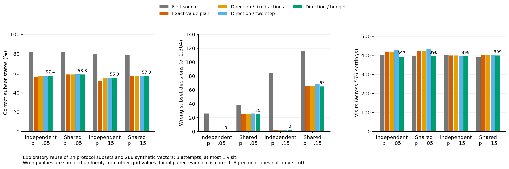

# 임상시험 사전선별에서 확인량·오류·방문 부담의 절충: 공개 조건과 합성 근거의 구성요소 평가

상태: **연구 종합 초안, 미제출**. 2026-10-22–23의 실행 결과를 종합했다. 선정된
KOSMI HWP와 별개다. 본문의 ‘확인’은 선택한 부분조건의 확인이며 전체 프로토콜의
참가 자격이나 등록 승인을 뜻하지 않는다. 저자·연구비·이해관계·제출 형식은 아직 확정하지 않았다.

## 초록

**배경:** 불완전한 기록에서 임상시험 후보를 검토하려면 다음에 어떤 자료를 얻고 어느
근거까지 믿을지 결정해야 한다. 같은 확인 한도라도 실패하는 경로, 추가 방문과 자료원
대조가 확인량을 바꾼다. 본 연구는 원문 의미·근거 충분성·내용 진실성을 분리해 평가했다.

**방법:** 과거 자료와 겹치지 않는 공개 중재 시험 48건을 개발·평가 24건씩 나누었다.
합성 평가 벡터 288개와 두 정보 가림에서 확인 1–3회·방문 0/1회의 순차 획득을 비교했다.
같은 시험의 논리 확대와 내용 오류·자료원 대조는 탐색 분석으로 구분했다. 정확한 값의
일치와 조건별 결론의 일치를 같은 행동 및 재계획으로 나눠 비교했다. 자동 원문 준비는
저자 문장·공개 문구와 별도 Leaf 주석의 48+24문구에서 실제 모델 추론으로 평가했다.

**결과:** 단순 부분조건에서 답이 항상 충분하면 다섯 정책 모두 상태 일치가 98.44%였다.
불완전한 답에서 실패 고려·남은 예산 계획은 충분한 답 가정·한 단계보다 1.91%포인트
높았지만 방문도 209→410회로 늘었다. 논리 확대의 차이 +1.48%포인트는 환자·시험 교차
재표집 민감도 [-1.69,4.38]에 0을 포함했다. 균등 오답·독립 5% 설정에서 조건별 대조는
정확한 값 대조보다 올바른 상태가 56.16→57.42%, 방문은 420→393회였으나 개선 대부분은
판정 기준에서 나왔다. 오류를 완전히 공유하면 조건별 대조에도 25/2,304개의 잘못된
결론이 남았다. 원문 준비의 개발 개선은 고정 코드의 새 24문구에 전이되지 않았다.
외부 참고식과의 문구 평균 일치는 기존 69.10%, 수정본 57.99%였다.

**결론:** 근거 품질과 대조 기준은 확인량·오류·보류·방문을 함께 바꿨다. 더 깊은 계획의
일관된 우위나 자료원 일치에 따른 진실성 보장은 관측되지 않았다. 결과는 제한한 부분조건의
계산 연구이며 전체 임상 적격 정확도·실제 오류율·환자 편익의 추정이 아니다.

**핵심어:** 임상시험 사전선별, 순차 정보 획득, 근거 충분성, 자료원 대조, 합성 평가

## 1. 서론

임상시험 사전선별에서는 검사값·사건 날짜·검증 상태가 부족해 결론을 내리지 못하는
경우가 있다. 다음 질문은 여러 시험을 한 번에 정리할 수 있지만, 해당 기록이 없거나
새 방문이 필요하면 기대한 확인이 이루어지지 않는다. 현재 날짜의 공식 기록이라도
내용이 틀릴 수 있다. 따라서 질문 선택의 점수만으로 전체 과정을 평가하기 어렵다.

동적 질문은 DQueST에 이미 제시되어 있으며[1], TrialTriage는 빠진 정보를 요청하고
답변을 같은 규칙에 넣어 재판정한다[6]. 능동 특징 획득 연구는 정책과 관측 분포가
연결되는 평가 문제를 다룬다[2]. 임상 성능을 주장하는 연구에서는 실제 기록과 독립
임상가 평가도 사용한다[3]. 본 연구는 이 시스템들과 같은 자료에서 성능을 겨룬 비교가
아니며, 질문 생성·반복 재판정·유한 예산 계획 자체의 최초성을 주장하지 않는다.

본 연구의 목적은 **같은 확인 기회 아래에서 근거를 더 얻거나 더 엄격하게 대조할 때
무엇이 개선되고 무엇을 잃는지** 밝히는 것이다. 세 질문을 검토했다.

1. 경로 실패와 남은 예산을 고려하면 확인량과 실제 방문은 어떻게 바뀌는가?
2. 두 자료의 수치 또는 조건별 결론을 대조하면 오류와 확인 기회는 어떻게 바뀌는가?
3. 수동 부분조건에서 얻은 정책 결과를 자동 원문 준비에도 적용할 근거가 있는가?

기여는 원문 의미, 사용할 근거의 충분성, 내용의 진실성을 구분하는 실행 가능한 평가와
그 절충 관계의 실증이다. 세 구성요소의 서로 다른 점수를 곱하거나 합쳐 전체 앱의
임상 정확도로 제시하지 않는다.

## 2. 방법

### 2.1. 확인 범위와 연구 구성

시험별 선택 조건은 수치·이진 비교와 모두/하나 이상 트리로 표현했다. 충분한 근거가
한 필수 조건의 위반을 보이면 부분조건 위반으로 정리하고, 선택 조건을 모두 확인하면
부분조건 충족으로 정리했다. 나머지는 미정이다. 후보 유지와 현재 확인 완료는 별도
상태다. 표현하지 않은 진단·병기·치료력·시점·절차를 충족했다고 간주하지 않았다.

| 평가 | 자료와 단위 | 독립성 및 범위 |
|---|---|---|
| 경로 선택 | 새 48시험 중 평가 24건·30비교식; 합성 288벡터×두 가림 | 과거 126시험과 분리. 평가 시험 19건은 비교식 하나 |
| 논리 확대·자료 대조 | 같은 평가 24건·93비교식; 확대된 특징의 288벡터×두 가림 | 결과를 본 뒤의 탐색. 비교식 하나인 시험은 8건 |
| 저자/공개 문구 준비 | 합성 15문장과 같은 평가 시험의 24문구; 실제 추론 30+48회 | 저자 부분 해석과 지원 문법의 구성요소 검사 |
| 외부 주석 준비 | Leaf의 서로 다른 시험 48+24문구; 실제 추론 96+48회 | 기존 프로젝트의 184시험을 제외. 후속 24문구는 앞선 48시험도 제외 |

표 1. 재생 횟수와 경계·누락 관측은 독립 환자 수가 아니다. 논리 확대에서는 특징과 합성
값을 다시 구성했으므로 첫 경로 선택의 점수와 직접 비교하지 않는다. 일반 임상 의미의
독립 정답은 없으며 외부 주석도 제한한 수치 참고식으로 취급한다.

### 2.2. 공개 시험·합성 값·근거 획득

ClinicalTrials.gov API v2에서 제2형 당뇨병·비만·만성 신장질환·심부전·유방암·
비소세포폐암의 모집 중/모집 예정 시험을 최근 수정 순서로 층당 100행씩 조회했다.
과거 126개 시험 번호와 중복을 제외하고 지원 가능한 수치 조건이 있는 중재 시험을
층당 8건 선택했다. 원문·인접 문맥은 저자가 검토했으며 독립 임상가 주석은 하지 않았다.
단위·대상 개념이 모호하거나 코호트·다중 행 논리를 단순 조건으로 펼칠 위험이 있는
경우는 첫 분석에서 제외했다. 고정 난수로 층당 개발/평가 4건씩 나눴다.

개발 벡터 384개로 라플라스 평활 주변분포를 계산하고 별도 난수의 평가 벡터 288개를
생성했다. 공통 잠재 분위수로 값 사이 상관을 만들되 계획에서는 독립 주변분포를 썼다.
고정 유한 격자는 실제 환자 분포가 아니다. 검색 층당 평가 시험 네 건을 적용해 설정별
시험 관측은 288×2×4=2,304개, 방문은 576개 벡터–가림 설정의 합계다.

기존 기록과 방문 검증의 충분한 답 확률을 각각 0.70/0.95로 두었다. 방문 한도는 전체
시도에서 0 또는 1회이며 한 경로를 반복 호출하지 않았다. 불충분한 반환은 답 없음,
90일 전 기록, 사건 날짜 없음, 환자 보고와 미검증으로 구성했다. 모든 정책에 같은
‘14일 이내 검증된 공식 기록’ 규칙을 적용했다. 품질·14일·방문은 합성 가정으로 실제
기관의 추정치나 프로토콜 전체의 기간 요구가 아니다. 실패도 행동과 실제 방문을 소비한다.
동일한 잠재 반환을 정책 간 공유하고 참값·오류 플래그·미래 반환은 정책에 주지 않았다.

### 2.3. 순차 계획과 비교 정책

상태에는 현재 사용할 값, 시도한 경로와 남은 확인·방문이 들어간다. 보상은 부분조건
충족/위반으로 정리된 시험 수다. 현재 상태를 s, 남은 행동을 b, 방문 한도를 v라 하면
유한 예산 재귀는 다음과 같다.

`V(s,b,v) = max{R(s), max_a E_o[V(T(s,a,o), b-1, v-cost(a))]}`.

R은 참값 정확도가 아닌 현재 규칙의 정리 수다. 다음 다섯 정책을 같은 실제 반환에서
비교했다. 동률이면 적은 방문·행동을 우선했다.

| 정책 | 선택 기준 | 실패의 계획 반영 |
|---|---|---|
| 영향 범위 포괄 | 미정 시험과의 연결 수 | 없음 |
| 충분한 답 가정·한 단계 | 다음 한 번의 기대 정리 수 | 항상 충분한 답 |
| 충분한 답 가정·남은 예산 | 남은 전체 행동의 기대 정리 수 | 항상 충분한 답 |
| 실패 고려·한 단계 | 다음 한 번의 기대 정리 수 | 경로별 성공·실패 |
| 실패 고려·남은 예산 | 남은 전체 행동의 기대 정리 수 | 경로별 성공·실패 |

방문 한 회당 보상 벌점 0.1/0.25/0.5는 후속 탐색으로 모두 공개했다. 논리 확대에서는
공개 잎의 결과가 같은 값을 묶어 계산했다. 독립 주변분포·값과 무관한 실패·해당 잎 결과와
자원에만 의존하는 비용/보상 아래 이 축약은 유한 예산 재귀를 보존한다. 실제 상관·값
의존 실패 아래 임상적으로 최적이라는 뜻은 아니다. 실제 판정에는 원래 반환값을 전달했다.

### 2.4. 내용 오류와 자료원 대조

메타데이터가 충분해도 수치가 틀릴 수 있도록 새 획득에 오류를 주입했다. 첫 분석은
유한 격자의 고정 비항등 이동, 후속은 참값을 제외한 격자에서 균등하게 뽑는 오답이다.
초기 기록은 올바른 것으로 두었다. 자료원별 오류 발생을 독립·절반 공유·완전 공유로
바꾸고 복사본은 같은 자료원 계열로 표시했다. ID 차이를 오류 독립의 증거로 보지 않았다.
조건부 독립은 진단 오류 모형에서도 별도로 두는 가정이다[5]. 실제 오류율은 추정하지 않았다.

대조 규칙은 날짜·단위·검증·동일 측정 범위·현재 충돌을 확인한 뒤 서로 다른 두 계열을
요구한다. 정확한 값 대조는 두 수치가 같아야 통과한다. 조건별 대조는 두 수치를 보존한 채
해당 조건의 충족/위반 방향이 같을 때 그 잎만 정리한다. 50/55는 `>=30`에는 같지만
`>=52`에는 다르다. 이 규칙은 임상 필수조건을 새로 만든 것이 아닌 연구용 근거 정책이다.

균등 오답 후속 비교는 오류 .05/.15×독립/완전 공유에서 첫 보고 전략, 정확한 값 계획,
그 행동 그대로의 조건별 판정, 방향을 반영한 두 단계/남은 예산 계획을 비교했다.
행동 고정 비교로 판정 기준과 선택 효과를 분리했다. 대조 계획은 개발 분포와 독립 오류
채널을 알며 첫 보고 전략은 내용 오류를 모형화하지 않는다. 첫 보고 대비는 정보 모형과
확인 규칙이 함께 다른 비교이고, 공유 오류는 계획 가정을 위반하는 스트레스다.

독립 채널을 L(t,y)=P(y|t), 개발 분포를 pi(t)라 하면 첫 보고 y 후 다음 보고의 분포는
`P(z|y)=sum_t pi(t)L(t,y)L(t,z) / sum_t pi(t)L(t,y)`다. 이 분포를 조건 방향과 예산
재귀에 연결했다. 모든 항목의 이중 대조가 임상 기본 규칙이라는 가정은 하지 않았다.

### 2.5. 자동 원문 준비와 외부 참고식

기존 준비는 추출한 원자를 평평하게 결합한다. 수정 준비는 지역 참조키와 원문 인용의
논리 묶음을 받고 지원 문법에서 연결·괄호·개수·범위·제외 부정을 다시 읽는다. 명시하지
않은 관계나 미표현 시점·비수치 조건은 보류한다. 같은 모델(`gpt-5.6-sol`, medium,
SDK/runtime 0.147.0)에서 방식·문구당 한 번 실제 구조화를 호출했다. 모델에는 원문과
위치만 주며 참고식·합성 정답을 주지 않았다. 실제 제안의 코드 교차 재생도 수행했다.

외부 평가에는 LeafAI 연구진의 공개 원문·논리 표현을 사용했다[7]. 같은 원문에서 주석
구문이 다른 경우는 임의로 고르지 않았고, 주석에 남은 비수치·시간 문맥을 삭제하지
않았다. 완전히 변환 가능한 수치 후보 153개에서 시험당 한 문구를 골랐다. 첫 48문구는
다중 사실 2·범위 16·단일 나이 15·다른 수치 15개다. 실행 전에 원문/주석의 연결·문맥
차이가 있는 9문구를 표시했다. 일반 BETWEEN 끝점의 네 해석이 다른 32관측을 제외해
393개 중 361개를 채점했다. 참고식의 미정과 참고 해석 자체의 모호성은 구분했다.

이 결과를 본 뒤 v9을 수정·고정하고 겹치지 않는 시험 24개에서 범위·단일 나이·다른
수치를 각 8문구 골랐다. 실행 전에 문맥 제한 6문구를 표시했고 128관측 중 끝점 해석이
갈리는 16개는 별도 보존했다. 동일 자료의 개발 재생을 이 새 문구 결과로 세지 않았다.
개념명을 정답에 맞추거나 원문/주석 오류를 고쳐 주 점수를 다시 계산하지 않았다.

### 2.6. 지표·불확실성·재현

정책 지표는 충분한 전체 합성 값으로 계산한 부분조건 상태와의 일치다. 올바른 충족/위반,
잘못된 확정/제외, 미정, 실제 시도·방문과 환자별 첫 후보를 별도로 기록했다. 첫 후보의
분모는 초기 후보 확인이 없지만 추가 확인으로 하나를 얻을 수 있는 벡터–가림 설정이다.
원문 행의 별도 참고 함수, 계획용 표현과 실제 판정 엔진을 대조했다. 이 구현 분리는
원문 해석의 의학적 정답을 보장하지 않는다.

환자 단위 구간은 같은 벡터의 두 가림을 묶고 검색 층을 유지한 5,000회 부트스트랩이다.
논리 확대에서는 환자와 시험을 각각 뽑는 pigeonhole bootstrap[4]을 참고한 민감도도
계산했다. 원래 행동을 고정한 재가중이며 새 후보 목록에서 재계획한 실험은 아니다.
외부 원문은 파생 관측 수가 다른 문구에 같은 가중치를 주고 문구 단위로 재표집했다.
모든 구간은 고정 목적 표집과 합성 생성기에 조건부이며 다중 비교의 확증 검정·임상
모집단 구간·동등성/비열등성 검정으로 사용하지 않았다.

## 3. 결과

### 3.1. 실패 고려는 확인과 방문을 함께 늘렸다

첫 경로 선택의 주 비교는 69,120회 재생이다. 확인 3회·방문 최대 1회의 결과는 다음과
같다. 기본 평가 단위는 합성 벡터 288개이며 재생 수를 독립 환자 수로 사용하지 않는다.

| 정책 | 이상적 답 | 불완전한 답 | 실제 방문: 불완전한 답 |
|---|---:|---:|---:|
| 영향 범위 포괄 | 98.44% | 87.02% | 166 |
| 충분한 답 가정·한 단계 | 98.44% | 88.06% | 209 |
| 충분한 답 가정·남은 예산 | 98.44% | 87.33% | 181 |
| 실패 고려·한 단계 | 98.44% | 88.24% | 576 |
| 실패 고려·남은 예산 | 98.44% | 89.97% | 410 |

표 2. 상태 분모 2,304관측, 방문은 576설정의 합계다. 깊은 계획끼리도 결과가 달랐다.
불완전한 답의 실패 고려·남은 예산과 충분한 답 가정·한 단계의 차이는 +1.91%포인트
(환자 단위 95% 범위 1.22–2.60)였다. 올바른 정리 44개 증가에 방문 201회 증가가
동반됐다. 방문을 금지하면 두 남은 예산 정책 모두 76.09%였다.

그림 1. 방문 벌점 0.25에서는 상태 일치 88.02%·방문 194회였다. 점추정의 근접함을
동등성으로 해석하지 않는다. 값 분포·경로 품질 변화와 모든 벌점은 상세 표 S1에 공개했다.

같은 반환에서 날짜·출처·검증 검사를 사후 제거하면 방문 허용 시 33/2,304관측에
잘못된 결론이 생겼다. 반대로 메타데이터를 유지한 내용 오류 5%에서는 두 주요 정책
모두 25/2,304개의 잘못된 결론을 냈다. 형식의 충분성과 내용의 진실성은 달랐다.

### 3.2. 논리 확대에서는 시험별 변화와 첫 후보가 달랐다

같은 평가 시험의 30→93비교식 확대에서는 실패 고려·남은 예산과 충분한 답 가정·
한 단계의 일치가 83.07/81.60%, 방문은 406/247회였다. 평균 차이 +1.48%포인트의
환자 구간은 .82–2.08이었으나 환자·시험 교차 재표집 민감도는 -1.69–4.38이었다.
24시험 중 개선 7·동일 15·하락 2건이었다. 한 복잡한 심부전 시험은 22.92%포인트
낮아졌다. 평균 개선을 모든 시험의 개선으로 해석하지 않는다.

충족 확인 수는 924→970개로 늘었지만 위반 정리는 956→944개였다. 첫 후보를 얻을 수
있는 324설정 중 새로 하나 이상 확인한 수는 298→302개였다. 방문 벌점 .5에서는
81.86%·방문 165회·첫 후보 299개였다. 후보 수 증가, 환자별 첫 후보와 부담의 변화는
일치하지 않았다. 내용 오류에서는 실패 고려 정책에도 29/2,304개의 오판이 남았다(S2).

### 3.3. 두 자료 대조에는 확인 기회비용과 공유 오류가 남았다

고정 오류 변환의 .05 설정에서 결과는 표 3과 같다. 올바른 상태에는 초기부터 올바른
729관측이 포함되며, 새 결론의 오류 비율을 별도로 보았다.

| 오류 | 첫 보고: 일치 /오판 | 정확한 값 대조: 일치 /오판 | 방문: 첫 보고 /대조 | 새 첫 후보: 첫 보고 /대조 |
|---|---:|---:|---:|---:|
| 독립 | 81.60% /29 | 56.16% /0 | 403 /392 | 299 /174 |
| 완전 공유 | 81.64% /43 | 58.59% /27 | 400 /395 | 297 /187 |
| 같은 계열의 복사본 | 81.64% /43 | 31.64% /0 | 400 /0 | 297 /0 |

표 3. 상태 분모 2,304, 방문 576설정, 첫 후보 기회 324설정이다. 복사본의 대조는 새
행동 없이 초기 상태만 유지한 결과다. 오류 0만으로 이를 성능 개선으로 평가할 수 없다.

독립에서 미래 답·참값을 아는 사후 최대 일치도 1,361/2,304=59.07%로 실제 56.16%
와의 차이는 67개였다. 세 행동·새 정보마다 두 반환이라는 자원 규칙이 회복량을
제한했다. 이 상한은 오류 0을 제약한 임상 상한이 아니다. 더 깊은 탐색만으로 첫 보고의
정리 수를 회복할 수 있는 조건은 아니었다.

완전 공유의 새 결론 중 오류는 첫 보고 43/1,195=3.60%, 대조 27/648=4.17%였다.
오류 총수가 적어도 새 결론의 오류 비율이 낮지는 않았다. 같은 HbA1c 오답을 두 자료가
공유한 합성 반례도 대조를 통과했다. 변경 폭·절반 공유·복사본 계열의 세부 결과는 S5에 있다.

### 3.4. 조건별 대조의 회복은 주로 판정 기준에서 나왔다

균등 오답의 별도 후속 비교는 11,520회 재생이다. 각 칸은 올바른 상태 수 /오판 수다.

| 오류 설정 | 정확한 값 계획 | 같은 행동·조건별 판정 | 조건별·남은 예산 | 방문: 정확한 값 /조건별 계획 |
|---|---:|---:|---:|---:|
| 독립 .05 | 1,294 /0 | 1,324 /0 | 1,323 /0 | 420 /393 |
| 완전 공유 .05 | 1,354 /25 | 1,354 /25 | 1,355 /25 | 424 /396 |
| 독립 .15 | 1,205 /2 | 1,271 /2 | 1,273 /2 | 399 /395 |
| 완전 공유 .15 | 1,317 /66 | 1,317 /66 | 1,320 /65 | 403 /399 |

표 4. 분모는 설정마다 2,304관측이다. 표 3과 오답 채널이 달라 두 표의 점수를 직접 잇지 않는다.

독립 .05에서 같은 행동의 판정 완화는 +30개, 재계획은 +29개였다. 재계획의 정확한 값
대비 차이는 +1.26%포인트(환자 구간 .65–2.04, 교차 민감도 .22–2.47)다. 첫 후보는
175→189개였다. 조건별 두 단계와 남은 예산은 모두 1,323개였으나 방문은 428/393회였다.
깊은 계획은 같은 행동보다 한 개 덜 맞았고 모든 설정에서 일관되게 우수하지 않았다.

같은 행동의 판정 완화는 이 표본에서 오판을 추가하지 않았다. 그러나 참값 50을 두
보고가 20/25로 잘못 표시하면 `>=30`을 함께 위반으로 판단한다. 정확한 값 대조는
보류하므로 조건별 대조의 추가 위험은 원리적으로 가능하다. 완전 공유 .05의 새 결론 중
오류 비율은 첫 보고 3.18%, 조건별 계획 3.84%였다. 관측 오판 0은 위험 0이 아니다(S6).

### 3.5. 자동 원문 준비의 개선은 새 문구에 전이되지 않았다

저자 문장의 정리 가능한 115관측에서 올바른 정리는 기존 41→수정 112개로 늘었다.
그러나 같은 평가 시험의 공개 24문구에서는 정리 가능한 358관측의 정리 일치가
92→56개로 줄고 보류는 241→302개로 늘었다. 일부 수치 참고식과 다른 보류를 모두
임상 오판으로 단정할 수 없지만 합성 문장의 개선을 일반화할 수도 없었다(S3–S4).

| 외부 주석 평가 | 문구 평균 일치: 기존 /수정 | 정리 일치: 기존 /수정 | 차이와 문구 단위 95% 범위 |
|---|---:|---:|---:|
| 첫 48문구, 고정 v8 | 64.23% /53.90% | 103/289 /74/289 | -10.33%p [-21.18,.09] |
| 코드 고정 후 새 24문구, v9 | 69.10% /57.99% | 54/88 /41/88 | -11.11%p [-25.70,2.43] |

표 5. ‘정리 일치’는 참고식이 확정/제외인 관측 중 같은 상태를 낸 수다. 미정까지 포함한
문구별 평균과 구분한다. 항상 보류하는 기준의 문구 평균은 각 22.17/22.22%였다.

첫 48문구의 반대 확정 4개·참고 미정에서의 결론 4개는 세미콜론 제외 문구의 임의
AND에서 발생했다. v9은 이 관계를 추정하지 않고 원문 질문을 남기도록 수정했다.
나이 표기·비교 문법도 고쳐 같은 v8 제안의 개발 재생은 68.00%가 됐다. 그러나 새
24문구의 실제 호출에서는 우위가 재현되지 않았다. 두 방식 모두 채점 관측에서 반대
확정/제외와 참고 미정의 결론은 없었지만 정리 가능 중 보류는 34→47개로 늘었다.

사전에 문맥 차이를 표시한 문구를 빼도 새 18문구의 차이는 -8.80%포인트였다. 결과 후
원문은 25–50 years인데 외부 주석은 MONTH인 사례도 발견했다. 입력·정답은 유지하고
민감도로 따로 공개했다. 외부 참고식 불일치를 실제 임상 오판으로 승격하지 않는다.
외부 실제 추론 144회와 앞의 78회는 모두 완료했지만 단일 모델·한 번 생성의 결과다(S7).

## 4. 고찰

본 연구는 ‘더 많은 확인’, ‘더 믿을 수 있는 결론’, ‘적은 환자 부담’이 같은 목표가
아님을 보였다. 실패를 고려한 정책의 확인 증가는 고품질 방문 경로의 추가 사용을
동반했다. 자료 대조는 독립 오류를 줄였지만 같은 확인 예산에서 정리 기회를 크게
소모했다. 조건별 대조는 일부 보류를 줄였으나 공유 오류와 잘못된 방향의 합의를
해결하지 못했다. 선택 알고리즘만 복잡하게 만드는 것으로 이 절충이 사라지지 않았다.

어느 층에서 틀렸는지도 구분해야 한다. 원문 관계가 틀리면 참인 수치를 얻어도 잘못
판정한다. 원문이 맞아도 날짜·출처가 불충분하면 현재 값으로 쓸 수 없다. 모든 형식이
맞아도 내용이 틀리면 대조 또는 사람 확인이 필요하다. 본 구현은 원문이 미지원이면
알려진 환자 근거를 유지하고 원문 연결·범위·시점 질문을 최종 후보 목록에 남긴다.
실행 가능한 환자 질문이 없어도 담당자 확인으로 종료하며 이를 환자 재검사로 자동
실행하지 않는다. 이 실행 흐름 수정은 임상가가 질문에 실제 응답한 실증과 다르다.

한계는 다음과 같다. 첫째, 목적 표집한 좁은 수치 부분조건과 합성 환자만 평가했다.
93개 비교식으로 늘린 뒤에도 전체 프로토콜의 의미를 표현하지 않았다. 실제 기록·독립
임상가 정답·검토 시간·모집률·환자 선호와 실제 품질을 측정하지 않았다. 둘째, 고정
격자·인위적인 성공률·올바른 초기 기록·독립 주변분포를 사용했다. 값 의존 실패 한
기전과 오류 공유 스트레스는 모든 임상 결측·측정 변동을 대표하지 않는다. 셋째, 논리
확대·대조·벌점·후속 코드 수정은 탐색이다. 구간은 모형에 조건부이며 임상 위험이나
새 시험 모집단의 우위·동등성을 입증하지 않는다.

넷째, 자동 원문 준비는 일반 우위를 입증하지 못했다. 문맥을 지워 점수를 높이거나
부정적 결과를 빼면 수동 입력의 정책 성능과 실제 입력의 간극을 숨기게 된다. 외부
주석도 원문 누락·단위 차이가 있어 임상 정답으로 그대로 쓸 수 없다. 반복 생성·다른
모델·독립 임상 의미 주석이 없으므로 오류 감소와 보류 증가의 임상 가치를 확정할 수 없다.
새 24문구는 단일 측정의 범위·나이·다른 수치로 제한해 복잡한 AND/OR의 전이 검증도 아니다.

실제 적용 전에는 전체 조건의 독립 주석, 측정 범위·자료원 의존성·획득 성공률과 환자
선호의 관측이 필요하다. 현재 연구용 정책이나 합성 수치를 기본 임상 전략으로 승격하지
않았다. 관측되지 않은 임상 검증을 논문 기여로 채우지 않는다.

## 5. 결론

공개 시험의 선택한 부분조건과 합성 근거에서 획득·대조 정책은 확인량·오류·보류·방문을
서로 바꾸었다. 실패 고려 계획의 작은 평균 이점은 추가 방문과 시험별 상반된 변화를
동반했고, 자료원 합의도 진실성을 보장하지 않았다. 자동 원문 준비의 개발 개선은 새
문구에 전이되지 않았다. 사전선별 연구는 이 구성요소와 실제 사용한 부담을 분리해
보고해야 하며, 현재 결과만으로 전체 임상 적격 정확도나 환자 편익을 주장할 수 없다.

## 상세 결과·재현 자료

세부 결과의 현행 기준은 [검증 결과 9–15절](CLARIFYTRIAL_VALIDATION_RESULTS.md)이다.
아래 S1–S7은 기존 결과를 찾아가는 색인이며 추가 독립 실험이나 새 정답 자료가 아니다.

| 상세 자료 | 내용과 파일 |
|---|---|
| S1 | 검증 9절. [첫 경로 비교](results/paper-acquisition-v1/): 다섯 정책·분포/품질 변화·벌점·가드 제거·내용 오류 |
| S2 | 검증 10절. [논리 확대](results/paper-logic-v2/): 시험별·충족/위반·첫 후보·교차 재표집·방문 민감도 |
| S3 | 검증 11절. [합성 문장](results/natural-protocol-v1/): 실제 추론 30회·185채점 관측·제안/코드 분해 |
| S4 | 검증 12절. [공개 문구](results/public-clause-v1/): 실제 추론 48회·보류·v8 개발 재생 |
| S5 | 검증 13절. [자료원 대조](results/corroboration-v1/README.md): 공유 오류·복사본·변경 폭·사후 상한 |
| S6 | 검증 14절. [조건별 대조](results/direction-corroboration-v1/README.md): 같은 행동·재계획·모든 오류 설정·반례 |
| S7 | 검증 15절. [외부 첫 48문구](results/leaf-protocol-v1/README.md)·[새 24문구](results/leaf-protocol-holdout-v1/README.md): 고정 입력·실제 제안·주석 문제·불확실성 |

공개 원문·이용 조건·수집 시각은 [자료 출처](../../DATA_SOURCES.md), 구성과 합성 규칙은
[실험자료](CLARIFYTRIAL_DATASETS.md), 구현 선택은 [설계](CLARIFYTRIAL_AGENT_ARCHITECTURE_REDESIGN.md)에 있다.
[공개 코드](https://github.com/health-agent/Clarifytrial/tree/codex/presentation-demo)는 MIT이며 제3자 허가 조건을
따로 보존한다. 원시 실행은 `runs/`, 유지할 고정 표·그림·실제 제안은 위 결과 폴더에 있다.
모델 재생은 실제 호출과 구분한다. 큰 재현 계산은 서버의 작업별 자원 제한 안에서 수행했다.

원문·단위·캐시·판정·실행 흐름의 관련 검사 176개, 기존 앱·안내의 영향 범위 검사
20개가 통과했다. 검사 통과를 원문의 임상적 정답 검증으로 사용하지 않는다. 모든 환자
값·사건·자료원 계열은 합성이며 실제 환자 기록은 사용하지 않았다. 윤리 심의·연구비·
저자 기여·이해관계의 제출 문구는 실제 연구 주체가 확인해야 하며 이 초안에 임의로 만들지 않았다.

이 결과는 의학적 조언이 아닌 참고용입니다. 임상시험 참가 가능성은 해당 시험의 최신 기준과 전체 자료를 바탕으로 다시 확인해야 합니다.

## 참고문헌

1. Liu C, Yuan C, Butler AM, et al. DQueST: dynamic questionnaire for search of clinical trials.
   *J Am Med Inform Assoc.* 2019;26(11):1333–1343.
   [doi:10.1093/jamia/ocz121](https://doi.org/10.1093/jamia/ocz121).
2. von Kleist H, Zamanian A, Shpitser I, Ahmidi N. Evaluation of Active Feature Acquisition
   Methods for Time-varying Feature Settings. *J Mach Learn Res.* 2025;26(60):1–84.
   [원문](https://www.jmlr.org/beta/papers/v26/23-1635.html).
3. Parikh RB, Kolla L, Beothy EA, et al. Human-AI teaming to improve accuracy and efficiency
   of eligibility criteria prescreening for oncology trials: a randomized evaluation trial using
   retrospective electronic health records. *Nat Commun.* 2026;17:2306.
   [doi:10.1038/s41467-026-68873-8](https://doi.org/10.1038/s41467-026-68873-8).
4. Owen AB. The pigeonhole bootstrap. *Ann Appl Stat.* 2007;1(2):386–411.
   [doi:10.1214/07-AOAS122](https://doi.org/10.1214/07-AOAS122).
5. Hui SL, Walter SD. Estimating the error rates of diagnostic tests. *Biometrics.*
   1980;36(1):167–171. [doi:10.2307/2530508](https://doi.org/10.2307/2530508).
6. Kern KA. TrialTriage, a Semiautonomous Prescreening Workflow for Resolving Ambiguity
   in Phase I Oncology Trial Eligibility: Development and Proof-of-Concept Study Using
   Synthetic Cases. *JMIR Form Res.* 2026;10:e100779.
   [doi:10.2196/100779](https://doi.org/10.2196/100779).
7. Dobbins NJ, Han B, Zhou W, et al. LeafAI: query generator for clinical cohort discovery
   rivaling a human programmer. *J Am Med Inform Assoc.* 2023;30(12):1954–1964.
   [doi:10.1093/jamia/ocad149](https://doi.org/10.1093/jamia/ocad149).
