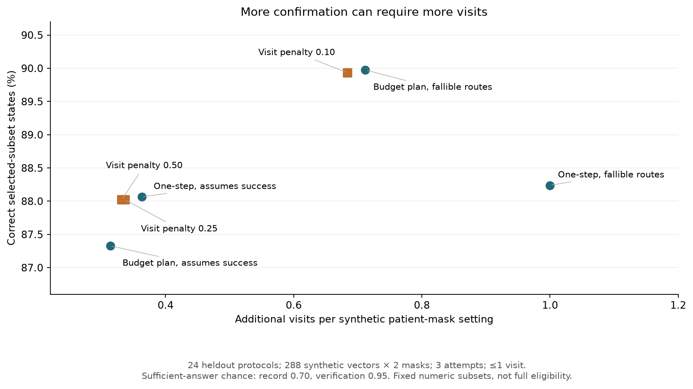
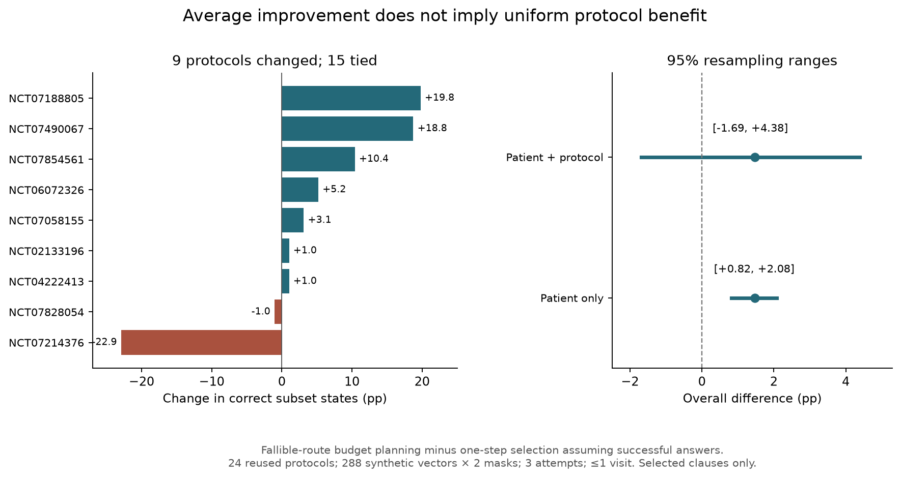
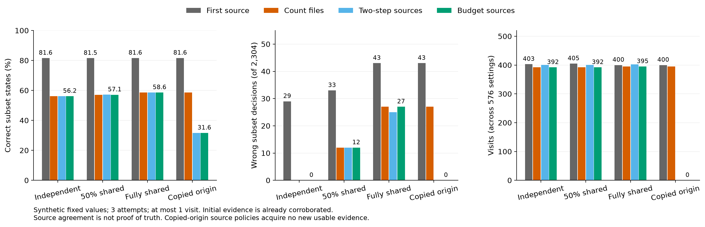

# 불완전한 근거와 방문 제약을 고려한 임상시험 부분조건의 순차 확인: 공개 시험 기반 합성 연구

상태: **활성 연구 원고 초안**. 2026-10-22–23 실행 결과를 바탕으로 작성했다. 선정된 KOSMI
HWP와 별개이며 제출본·임상 검증 완료본이 아니다. 아래의 ‘확인’은 선택한 수치 조건의
확인을 뜻한다. 전체 프로토콜의 참가 자격을 확정하지 않는다.

## 초록

**배경:** 임상시험 사전선별에서 필요한 정보가 없거나 오래된 기록만 있을 때에는 다음에
확인할 정보와 이를 얻을 경로를 함께 결정해야 한다. 같은 정보를 묻더라도 충분한 답을
얻지 못할 수 있고, 대체 경로는 추가 방문을 요구할 수 있다.

**방법:** ClarifyTrial의 근거 기반 상태 갱신에 실패 가능한 확인 경로와 유한 예산 계획을
결합했다. 2026년 10월 22일 ClinicalTrials.gov의 여섯 검색 층에서 기존 자료와 겹치지 않는
중재 시험 48건을 선택하고, 계산 가능한 수치 부분조건 60개를 구성했다. 시험 번호를
개발·평가 각각 24건으로 분리한 뒤, 별도 합성 평가 벡터 288개와 두 정보 가림을 생성했다.
포괄 선택, 한 단계 기대효과, 남은 예산 계획을 비교하면서 경로 실패 고려 여부를 분리했다.
확인 예산은 1–3회, 방문 상한은 0 또는 1회로 설정했다. 이상적 답, 불완전한 답, 값 분포
변화와 경로 품질 변화를 평가하고, 방향별 확인·방문·미정을 함께 기록했다.

**결과:** 확인 3회·방문 최대 1회에서 이상적 답의 상태 일치는 모든 방법이 98.44%였다.
불완전한 답에서는 실패를 고려한 남은 예산 계획이 89.97%, 충분한 답을 가정한 한 단계
선택이 88.06%였다. 차이는 1.91%포인트로, 고정 프로토콜에 조건부인 환자 단위 95%
부트스트랩 범위는 1.22–2.60%포인트였다. 그러나 두 방법의 추가 방문은 576개 환자–가림
설정에서 각각 410회와 209회였다. 방문 벌점을 높이면 방문 191–194회, 일치 88.02%로
변했다. 이 첫 비교의 방문 금지에서는 실패 고려의 추가 이점이 사라졌다. 후속 탐색에서
같은 평가 시험의 논리 비교식을 30개에서 93개로 넓히자 불완전한 답 일치는 83.07%와
81.60%였다. 그러나 환자와 시험을 함께 재표집한 차이 범위는 -1.69–4.38%포인트였다.
추가 스트레스에서 검증
표시가 정상인 반환의 5%에 수치 오류를 넣자 새 방법도 2,304관측 중 25개를 잘못 확정하거나 제외했다.
별도 공개 문구 24개의 자동 준비 검사에서는 참고 부분 해석과 다른 결론은 줄었으나,
정리 가능한 358관측의 올바른 정리도 92개에서 56개로 줄고 보류가 증가했다.
자료원 대조를 추가한 합성 비교에서는 독립 오류의 잘못된 결론이 29개에서 0개로
줄었지만 일치도 81.60%에서 56.16%로 줄었다. 오류를 완전히 공유하면 대조에도 27개가 남았다.

**결론:** 선택한 수치 부분조건의 합성 평가에서는 탐색의 깊이보다 충분한 근거를 얻을
가능성과 대체 경로의 부담을 함께 다루는 것이 중요했다. 확인 증가에는 방문 증가가
동반될 수 있었다. 이 결과는 근거 부족을 미정으로 유지하고 성능과 부담을 함께 보고하는
설계를 뒷받침하지만, 전체 임상시험 적격 정확도나 임상적 편익을 입증하지 않는다.

**핵심어:** 임상시험 사전선별, 순차 정보 획득, 근거 충분성, 환자 제약, 합성 평가

## 1. 서론

임상시험 사전선별은 환자 설명과 시험 조건을 한 번 비교하는 작업에서 끝나지 않는다.
검사값이 없거나 사건 날짜가 불명확하면 후보를 남겨 둔 채 추가 자료를 요청해야 한다.
다음에 어떤 정보를 확인하느냐는 여러 후보의 정리 속도를 바꾸며, 그 정보를 실제로
얻을 수 있는지와 환자가 방문할 수 있는지도 결과에 영향을 준다.

동적 질문을 통해 후보를 줄이는 접근은 이미 DQueST 등에 제시되어 있다[1]. 따라서 여러
시험이 공유하는 질문이나 답변 후 재판정 자체를 새 기여로 삼기는 어렵다. 능동 특징 획득
연구는 획득 정책 변화가 관측 분포도 바꾼다는 평가상의 문제를 다룬다[2]. 임상 현장에 대한
주장은 실제 기록과 독립 임상가 정답을 사용하는 연구와 구분해야 한다[3].

본 연구는 ‘어떤 질문이 가장 많은 시험에 연결되는가’에서 한 단계 더 나아가, 제한된 시도
안에서 충분한 근거를 얻을 가능성과 방문 한도를 함께 고려한다. 새로운 일반 최적화
알고리즘을 제안하기보다, 근거가 불충분한 반환과 대체 경로를 포함한 상태 전이를 구현하고
그 효과와 부담을 분리해 측정한다. 연구 질문은 다음과 같다.

1. 충분한 답을 항상 얻는 설정과 그렇지 않은 설정에서 선택 방법의 차이가 달라지는가?
2. 경로 선택·자료원 대조는 확인·오류·실제 방문을 어떻게 함께 바꾸는가?
3. 개발 값 분포·경로 품질과 오류 독립 가정이 달라졌을 때 차이가 유지되는가?
4. 수동으로 구조화한 조건의 정책 결과를 자유 문장 입력에도 적용할 수 있는가?

## 2. 방법

### 2.1. 상태와 확인 범위

각 시험은 원문에 연결된 수치 조건의 집합으로 표현했다. 현재 충분한 근거에서 조건
하나를 위반하면 해당 부분조건 집합은 위반으로 정리했다. 모든 선택 조건이 충분한 근거로
충족되면 부분조건 충족을 확인했다. 그 외에는 미정으로 남겼다. 후보 유지 여부와 현재
확인 완료 여부를 구분하고, 반환 근거가 불충분하면 숫자가 있어도 현재 값으로 쓰지 않았다.

첫 비교는 무조건 적용되는 단순 수치 조건들의 결합에 한정했다. 나이·성별·진단·병기·
치료력·선행 절차 등 구조화하지 않은 프로토콜 조건은 충족했다고 간주하지 않는다.
부분조건 충족을 전체 임상시험 참가 가능이나 등록 승인으로 제시하지 않는다.

### 2.2. 공개 시험과 분할

ClinicalTrials.gov API v2에서 제2형 당뇨병, 비만, 만성 신장질환, 심부전, 유방암,
비소세포폐암을 검색했다. 모집 중 또는 모집 예정 상태의 시험을 최근 수정 순서로
검색 층당 100행씩 수집했다. 검색 층은 조회 기준이며 전문가가 확정한 질환 분류가 아니다.

기존 자료의 시험 번호 126개를 제외하고, 중복을 제거한 뒤 지원 가능한 수치 조건이 있는
새 중재 시험을 조회 순서대로 층당 8건 선택했다. 단위가 불분명하거나 수치가 다른 개념을
가리키는 문장, 복수 단계·코호트와 다중 행 OR가 필수 조건으로 잘못 펴질 위험이 있는
시험은 제외했다. 원문과 인접 문맥은 저자가 검토했다. 독립 임상가 주석은 수행하지 않았다.
선택 후 고정 난수로 층당 4건씩 개발과 평가에 배치했다. 환자 값과 정책 결과는 이후에
생성했다.

전체 48건에서 선택한 조건은 60개다. 개발·평가는 각각 24건·30조건이며 각 분할의
19건은 조건 하나만 포함한다. 전체 시험 원문의 비어 있지 않은 행 1,394개에는 제목과
설명도 포함되므로 이를 전체 조건 개수로 취급하지 않는다. 이 자료는 광범위한 원문
포괄 평가가 아닌 보수적인 부분조건 평가다. 원문·주소·수집 시각·변환값·제외 사유는
파생자료에 남겼다.

### 2.3. 합성 값과 정보 가림

각 특징은 고정된 유한 값 격자에서 생성했다. 층당 개발 벡터 64개, 총 384개로 라플라스
평활 주변분포를 계산했다. 평가 벡터는 별도 난수의 층당 48개, 총 288개다. 두 가림에서
일부 사실만 먼저 제공하고 나머지를 확인 대상으로 남겼다. 같은 벡터의 가림은 독립 환자로
세지 않았다.

생성기는 공통 잠재 분위수를 사용해 특징 사이 상관을 만들지만 계획은 독립 주변분포로
근사했다. 값 분포 변화에서는 잠재 분위수의 변환만 바꾸고 개발 분포는 유지했다.
고정 값 격자와 공동 생성 규칙은 실제 질환의 유병 분포나 생리적 관계를 재현하지 않는다.
변형 벡터를 임상 환자군의 외부 검증 자료로 해석하지 않는다.

### 2.4. 확인 경로와 불충분한 반환

각 정보에 기존 기록 조회와 방문 검증의 두 경로를 두었다. 기존 기록의 충분한 답 확률은
0.70, 방문 검증은 0.95로 설정했다. 방문 검증은 추가 방문 한 회를 소모한다. 이 수치는
실제 의료기관에서 추정한 값이 아니다. 환자에게 허용된 방문은 전체 시도에서 합계 0 또는
1회이며, 한 경로를 반복 호출하지 않고 실패 후 다른 경로를 검토할 수 있다.

불충분한 반환은 답 없음, 90일 전 기록, 사건 날짜 없음, 환자 보고 출처, 미검증 상태로
구성했다. 일부 반환에는 현재와 다른 값도 포함했다. 충분한 답은 현재 실제 값과 일치한다고
가정했다. 모든 방법에 14일 이내의 검증된 공식 기록이라는 같은 근거 품질 정책을 적용했다.
14일은 합성 실험 가정이며 원문 전체의 실제 기간 요구를 옮긴 값이 아니다.

실패는 행동과 방문 예산을 소비하지만 현재 값에 대한 정보를 주지 않는다고 모델링했다.
각 경로의 실제 반환 사건은 같은 환자에서 비교 방법 사이에 공유했다. 선택기는 공개 조건,
개발 주변분포, 경로 품질 가정과 이미 관측한 근거만 받았다.

### 2.5. 순차 계획과 비교군

선택 보상은 확인 또는 위반으로 정리된 부분조건 집합의 수다. 상태에는 현재 쓸 수 있는
값, 이미 시도한 경로와 남은 행동·방문이 포함된다. 계획기는 경로 성공 시 가능한 값에
대한 기대값과 실패 시 미정 상태로 남는 가지를 계산한다. 최대 세 번의 시도를 유한 예산
재귀로 탐색한다. 방문을 금지한 가지는 처음부터 선택하지 않는다.

다음 다섯 방법을 같은 상태 전이와 실제 반환에서 비교했다.

| 방법 | 정보 선택 | 경로 실패 모델 |
|---|---|---|
| 영향 범위 포괄 | 현재 미정 시험과의 연결 수 | 선택 기대효과에 미반영 |
| 충분한 답 가정·한 단계 | 다음 한 번의 기대 확인 수 | 항상 충분한 답 가정 |
| 충분한 답 가정·남은 예산 | 남은 전체 시도의 기대 확인 수 | 항상 충분한 답 가정 |
| 실패 고려·한 단계 | 다음 한 번의 기대 확인 수 | 경로별 실패 포함 |
| 실패 고려·남은 예산 | 남은 전체 시도의 기대 확인 수 | 경로별 실패 포함 |

동률이면 적은 방문과 적은 행동을 우선했다. 기본 분석 후 방문 한 회당 보상 벌점
0.1, 0.25, 0.5를 모두 적용한 탐색적 민감도를 추가했다. 이는 평가 자료에서 좋은
설정을 골라 새 독립 결과로 제시하기 위한 분석이 아니다.

### 2.6. 평가와 불확실성

주 지표는 현재 부분조건 상태와 충분한 전체 값으로 계산한 상태의 일치율이다. 충족
확인과 위반 정리, 초기부터 정리된 수, 시도, 추가 방문과 미정을 따로 기록했다. 잘못된
확정·제외와 방문 한도 초과도 검사했다. 원문 행을 직접 계산하는 별도 함수, 계획기와
기존 실제 판정 엔진의 결과를 모든 재생에서 대조했다. 이 코드 분리는 원문 해석의
의학적 정답을 보증하지 않는다.

이상적 답, 불완전한 답, 값 분포 변화, 경로 품질 변화를 구분했다. 경로 품질 변화에서는
계획의 0.70/0.95를 유지하고 실제 품질만 0.50/0.85로 낮췄다. 확인 예산은 1·2·3회,
주 비교는 3회였다. 같은 환자의 두 가림을 묶고 검색 층을 유지해 환자 단위 부트스트랩을
5,000회 수행했다. 구간은 고정된 프로토콜과 합성 생성기에 조건부다. 시험 표본 추출의
불확실성이나 임상 일반화를 포함하지 않으며 다중 비교의 확증적 유의성을 주장하지 않는다.

### 2.7. 같은 원문의 논리 확장과 시험별 민감도

첫 비교 후 같은 48개 시험과 분할을 유지하면서 평가 쪽 원문에 연구자가 선언한 논리
묶음 30개를 추가했다. 개발 쪽은 비교식 30개를 유지하고 평가 쪽은 수치·이진 비교식
93개로 늘렸다. 이 수에는 같은 사실의 여러 경계와 반복된 표지 비교도 포함되므로
서로 다른 임상 조건의 수로 해석하지 않는다. 비교식 하나만 포함한 평가 시험은
19건에서 8건으로 줄었다. 새 독립 검증이나 자동 자연어 구조화 평가가 아닌 탐색적
원문 확장이다. 임상가가 독립 주석한 자료도 아니다.

원문의 범위·대안·예외를 모두/하나 이상 트리로 보존했다. 예를 들어 UACR과 eGFR의
세 가지 대안, LVEF에 따른 NT-proBNP 기준, 간 전이 여부에 따른 간수치 상한을 표현했다.
제외 조건의 복합 술어를 부정할 때는 잎의 의미와 연결 연산자를 함께 뒤집었다.
부호·값·단위 변환을 원문과 대조했으며, 설명과 HbA1c 부호가 상충해 보이는 원문은
임의로 수정하지 않고 보류했다. 시간·단계·검사 방법·다른 치료력 의미는 남을 수 있다.

계획에서는 모든 공개 잎의 결과가 같은 수치들을 한 가지로 묶고 확률을 더했다. 공개된
다른 사실의 분포가 독립이고 실패가 값에 무관하며 비용·보상이 잎의 결과와 남은 자원에만
의존하면 이 축약은 유한 예산 재귀의 값을 보존한다. 종료 보상은 같은 잎 결과에서
같고, 다음 성공·실패의 가지와 허용 행동이 같으므로 남은 예산에 대한 귀납으로 성립한다.
실제 상관이나 값 의존 실패 아래 최적성이 보장된다는 주장은 아니다. 실제 환자 반환값은
축약하지 않고 판정 엔진에 원래 값을 전달했다.

확장한 특징 집합에서 합성 벡터를 다시 생성해 같은 여섯 품질·분포 조건을 평가했다.
개선이 소수 시험에 몰리는지 보기 위해 환자–시험별 차이를 따로 기록했다. 추가 분석은
행과 열을 별도로 뽑는 pigeonhole bootstrap[4]을 참고해 검색 층 안에서 환자와 시험을
각각 재표집했다. 원래 후보 집합에서 실행한 행동은 고정했다. 새 시험 목록으로 질문을
다시 고른 결과가 아니며, 목적 표집한 시험의 모집단 일반화 구간으로 사용하지 않는다.

### 2.8. 자유 문장 준비의 구성요소 검사

수동 원문 트리와 실제 자유 문장 준비 사이의 차이를 별도로 평가했다. 기존 준비는
모델이 추출한 원자를 모두 필수로 결합했다. 새 준비는 지역 참조키·원문 인용의 논리
묶음을 받고, 지원 문법에서 관계를 다시 읽어 검증한다. 포함/제외 AND·OR, 명시한
괄호, 평평한 개수 목록과 같은 측정의 범위를 지원하며 모호한 범위는 보류한다.
모델 제안이 존재하거나 출처 인용이 맞는 것만으로 임상 의미가 검증됐다고 간주하지 않는다.

저자가 만든 합성 영어 문장 15개에서 기존/새 방식 각각 한 번씩 원문 구조화 모델을
호출했다(`gpt-5.6-sol`, `medium`, SDK/runtime `0.147.0`). 수치 정답을 명확히 정의한
12문장에서는 경계·대표값·누락의 185관측을 가능한 완전 수치의 참고 계산과 비교했다.
그중 정리 가능한 관측은 115개였다. 환자 구조화와 비수치 문장 판단 모델은 사용하지
않았다. 나머지 모호한 문장 3개에는 임상 정오를 부여하지 않았다. 실제 제안을 반대편
코드에 다시 넣어 계약/원자 추출과 코드의 효과도 분해했다. 이 표본은 지원 문법과
밀접한 탐색 검사이며 독립 NLP 표집이나 임상 검증이 아니다. 파생 관측에 신뢰구간을
붙이지 않았다.

### 2.9. 공개 문구에서의 처리 범위

합성 문장의 결과를 공개 문구에서도 확인하기 위해 같은 평가 시험 24건에서 시험별
선언 잎 수가 가장 많은 원문 묶음 하나를 선택했다. 동률이면 앞선 원문 행을 골랐다.
이는 이미 사용한 저자 선언의 탐색적 재사용이며 독립 NLP 주석이 아니다. 전체
임상 의미 대신 선택한 수치·이진 부분 해석과의 일치를 비교했다. 시점·진단·방법과
예외를 포함한 원문은 삭제하지 않았다.

경계 위·아래·같음과 누락의 448관측을 만들었고, 큰 두 묶음은 고정 난수로 129개씩
선택했다. 부분 해석에서 정리 가능한 관측은 358개였다. 기존·고정 새 코드(v7)에서
각각 24회 실제 구조화 모델을 호출했다. 모델·추론·실행기는 2.8절과 같았다. 항상
보류하는 기준과 실제 제안의 코드 교차 재생도 비교했다. 후속 v8은 결과를 본 뒤의
원자 위치·명시한 행 연결 수정으로 구분했다. 관측을 독립 환자로 세거나 전체 임상
정답·전체 앱 성능으로 해석하지 않았다.

### 2.10. 자료원 대조와 공유 오류

두 자료의 일치를 내용 검증으로 볼 수 있는지 추가 평가했다. 호출자가 명시한 자료원
계열·측정 범위를 사용하고, 기존 날짜·출처·검증·단위 검사를 통과한 최신 사건 날짜의
값이 정확히 같아야 대조를 통과하도록 했다. 복사본은 같은 계열로 센다. 이는 연구용
추가 검토 정책이며 원문의 임상 필수 조건이 아니다. 자료원 ID의 차이는 오류의 독립을
보장하지 않는다. 기존 진단검사 추론에서도 조건부 독립은 명시한 모형 가정이다[5].
본 연구는 그 진단 오류율 추정법을 구현하거나 실제 품질을 추정한 것이 아니다.

같은 시험·합성 벡터를 재사용하되 초기 기록은 이미 올바르게 대조된 것으로 뒀다.
새 보고마다 오류 확률 0.05를 주고, 오류가 나면 두 칸 이동하되 이진에는 한 칸을
적용했다. 독립·절반 공유·완전 공유는 주변 오류 확률을 기대상 같게 유지하는 공유
스위치로 만들었다. 복사본에서는 두 경로의 계열도 같다고 미리 알렸다. 모든 방법에
같은 잠재 반환을 주며 오류 플래그·참값·미래 답은 선택기에 전달하지 않았다.

첫 기록을 쓰는 기존 남은 예산, 파일 수만 세는 대조, 계열을 구분하는 두 단계/남은
예산 계획을 비교했다. 대조 계획은 첫 보고의 임시 값도 상태에 포함한다. 독립 오류
가정에서 첫 보고 `y`의 확률은 `(1-p)pi(y)+p*pi(f_inverse(y))`이고, 두 번째가 같을
확률은 `[(1-p)^2*pi(y)+p^2*pi(f_inverse(y))]/P(y)`다. `pi`는 개발 주변분포, `f`는
명시한 비항등 오류 변환이다. 2.5절의 유한 예산 재귀로 대조된 정리 수를 최대화한다.
진실 판정 정확도를 직접 최적화하는 보상은 아니다.

첫 기록 비교군은 내용 오류를 모형화하지 않는 기존 정책을 사용했다. 대조 계획은
정해 둔 합성 오류 확률도 쓰므로 정보 모형과 확인 규칙이 함께 다른 비교다. 두 단계와
남은 예산의 대조 비교는 같은 정보·규칙 아래에서 선택 방법을 비교한다.

행동 1–3회·방문 0/1회의 주 비교와 한 칸 이동 민감도를 각각 55,296회 실행했다.
같은 관측의 정책·가림·공유 조건을 독립 환자로 더하지 않았다. 세 행동 안에서 새
정보마다 두 반환이 필요하면 새로 대조할 정보는 최대 하나다. 미래 답·참값을 아는
사후 계산으로 가능한 한 쌍을 전부 비교해 이 규칙의 최대 일치 수도 구했다.

## 3. 결과

### 3.1. 답의 품질에 따른 차이

주 비교에는 69,120개의 재생이 있다. 이는 동일한 합성 벡터·가림·방문·예산·방법·설정의
반복 수이며 독립 환자 수가 아니다. 기본 값 설정에서 288벡터 × 두 가림 × 시험 네 건은
2,304개 시험 관측이다. 전체 값 기준 충족은 1,584개, 위반은 720개이며, 처음부터
일치한 596개에는 충족 확인 380개와 위반 정리 216개가 포함된다.

| 확인 3회·방문 최대 1회 | 이상적 답 | 불완전한 답 | 값 분포 변화 | 경로 품질 변화 |
|---|---:|---:|---:|---:|
| 영향 범위 포괄 | 98.44% | 87.02% | 87.15% | 77.47% |
| 충분한 답 가정·한 단계 | 98.44% | 88.06% | 88.80% | 79.08% |
| 충분한 답 가정·남은 예산 | 98.44% | 87.33% | 88.11% | 77.73% |
| 실패 고려·한 단계 | 98.44% | 88.24% | 88.32% | 79.56% |
| 실패 고려·남은 예산 | 98.44% | 89.97% | 90.54% | 81.12% |

이상적 답에서는 깊은 계획이 추가 이점을 보이지 않았다. 불완전한 답에서 실패 고려·
남은 예산은 충분한 답 가정·한 단계보다 1.91%포인트 높았으며 95% 범위는
1.22–2.60%포인트였다. 같은 남은 예산끼리의 차이는 2.65%포인트, 실패 고려 한 단계
대비 차이는 1.74%포인트였다. 다섯 검색 층에서 수치상 개선했고 신장질환 층에서는
차이가 없었다. 추가 방문을 금지하면 두 남은 예산 방법은 모두 76.09%였다.

### 3.2. 추가 확인과 방문 부담

불완전한 답에서 충분한 답 가정·한 단계는 충족 1,406개와 위반 623개를 정리하고 방문
209회를 사용했다. 실패 고려·남은 예산은 충족 1,438개와 위반 635개를 정리하면서 방문
410회를 사용했다. 두 방법 모두 1,459회 시도했다. 같은 방문 상한은 같은 실제 방문을
뜻하지 않았고, 확인 44개 증가에 방문 201회 증가가 동반됐다.

방문 벌점 0.1에서는 일치 89.93%·방문 394회였고, 0.25에서는 88.02%·194회,
0.5에서는 88.02%·191회였다. 작은 점수 차이를 동등성으로 해석하지 않는다.
민감도의 모든 점은 그림 1과 결과표에 공개했다.

그림 1의 단위는 576개 환자–가림 설정의 평균 방문과 부분조건 상태 일치다. 환자 부담을
독립적인 수치로 보여 주기 위한 탐색적 민감도이며 실제 비용이나 선호의 추정이 아니다.

### 3.3. 근거 충분성과 원문 단위

실행된 근거 가드 아래에서 잘못된 확정·제외와 방문 한도 초과는 관측되지 않았다.
같은 실패 고려·남은 예산의 반환에 대해 날짜·출처·검증 상태를 무시하고 수치만 사용하면
방문 허용 시 33/2,304관측, 방문 금지 시 199/2,304관측에서 잘못된 확정·제외가 발생했다.
이는 같은 경로의 사후 가드 제거 실험이며, 선택까지 바꿔 재실행한 별도 정책 비교가 아니다.

자료 구성 중에는 `mg/dL`와 `g/dL`의 부분문자열 일치, `x10^3/uL`의 배수 누락,
현재 체중과 체중 변화, eGFR과 EGFR 유전자, 체표면적 보정 유무의 혼동을 발견했다.
이 문제에 대한 보수적 수정과 회귀 검사를 추가했다. 이 발견을 전체 원문 추출 정확도가
검증됐다는 뜻으로 해석하지 않는다.

### 3.4. 근거의 내용 오류와 값에 의존하는 실패

기본 분석 후 같은 합성 벡터와 시험에 두 스트레스를 추가해 34,560회 재생했다. 첫 조건은
충분한 것으로 표시된 반환 중 5%의 수치를 다른 격자 값으로 바꾸면서 현재 날짜·공식 출처·
검증 표시를 유지했다. 5%는 임상 추정이 아닌 합성 설정이다. 두 번째는 정보·경로별 평균
충분한 답 확률을 기존과 같게 유지하면서 가린 값이 높을수록 실패하기 쉽게 만들었다.
계획기는 실패가 값에 의존한다는 사실을 모른다.

확인 3회·방문 최대 1회에서 내용 오류 조건의 일치는 충분한 답 가정·한 단계가 87.11%,
실패 고려·남은 예산이 88.89%였다. 두 방법 모두 25/2,304관측에서 잘못 확정·제외했다.
날짜·출처·검증 상태를 검사하는 장치만으로는 거짓 수치를 알아낼 수 없었다. 값에 의존하는
실패에서는 각각 88.37%와 90.32%였다. 이 결과는 선택한 합성 기전에 한정되며 비무작위
결측 전체에 대한 강건성을 입증하지 않는다.

원문 범위를 보존하기 위해 모든 시험에 선택한 조건과 나머지 원문 행 위치를 나란히
저장했다. 선택한 조건의 충족 여부와 별개로 전체 프로토콜 확인 허용 표시는 모두 거짓이다.
이 범위 표시는 임상 정답을 추가한 것이 아니라 지원하지 않는 조건을 숨기지 않기 위한 것이다.

### 3.5. 논리 확장, 시험별 차이와 환자별 첫 후보

논리 확장은 103,680회의 재생과 27,648회의 방문 벌점 민감도로 평가했다. 특징과 값이
달라졌으므로 첫 단순 부분조건 점수와 직접 비교하지 않는다. 방문 최대 1회·확인 3회에서
실패 고려·남은 예산과 충분한 답 가정·한 단계의 일치는 이상적 답에서 90.02%와
89.02%, 불완전한 답에서 83.07%와 81.60%였다. 경로 품질 하락에서는 76.17%와
75.91%로 차이가 줄었다. 내용 오류가 있는 반환에서는 새 방법도 29/2,304관측을
잘못 확정하거나 제외했다.

불완전한 답의 평균 차이는 1.48%포인트지만 시험 24건 중 개선 7건·동일 15건·하락
2건이었다. 한 복잡한 심부전 시험은 22.92%포인트 낮아지고 같은 검색 층의 다른 두
시험은 각각 19.79·18.75%포인트 높아졌다. 환자만 재표집한 범위는
0.82–2.08%포인트였으나 시험도 다시 뽑는 민감도는 -1.69–4.38%포인트였다.
이 범위는 원래 행동 기록의 가중치 민감도이며 새로운 후보 목록의 성능 구간이 아니다.

새 방법은 부분조건 충족 970개·위반 944개를 정리하고 방문 406회를 썼다. 한 단계는
충족 924개·위반 956개와 방문 247회였다. 처음에 충족 후보가 없지만 추가 확인으로
하나를 얻을 수 있는 324개 환자–가림 설정에서, 적어도 한 후보를 확인한 수는
302개와 298개였다. 확인한 후보 개수 증가와 첫 후보를 얻는 설정의 증가는 달랐다.

방문 벌점 0.1/0.25/0.5의 일치는 82.42/81.94/81.86%, 방문은 354/189/165회였다.
벌점 0.5의 한 단계 대비 차이는 0.26%포인트였으나 환자 범위는 -0.39–0.91,
교차 재표집 민감도는 -2.86–3.17%포인트로 0을 포함했다. 해당 설정에서 첫 후보를
얻은 수는 299개였다. 점추정이 비슷하고 방문이 적다는 사실만으로 동등성이나 비열등성을
주장하지 않는다. 모든 벌점 결과를 공개했고 기본 실행 전략으로 승격하지 않았다.

### 3.6. 원자 추출과 원문 관계의 분리

실제 모델 제안을 사용한 상태 일치는 기존 109/185에서 새 방식 182/185로 변했다.
정리 가능한 115관측에서 올바른 정리는 41→112개, 보류는 72→3개, 잘못 제외는
2→0개였다. 원래 미정인 관측에서 성급하게 결론 낸 수는 2→0개였다. 잘못 확정은
양쪽 모두 0이었다. 문장 전체의 일치는 3/12→11/12였고 계약·실행 실패는 없었다.

기존 실제 제안을 새 코드에서 재생하면 올바른 정리는 45/115였다. 새 실제 제안에서
지역 키와 논리 묶음만 제거해 기존 계약으로 재생하면 68/115, 잘못 제외 8개와
미정에서 성급한 결론 16개였다. 원자 분리를 더 잘하는 제안만으로 평평한 결합을
해결하지 못했다. 프롬프트·계약·컴파일러가 함께 바뀌므로 전체 차이를 한 요소에
귀속하지 않는다.

새 방식의 남은 세 보류는 ECOG의 논리 해석 실패가 아니라 개념 연결 문제였다.
모델의 `ECOG performance status`와 고정 환자 코드 `ecog`를 표기 정규화만 하는
판정기가 연결하지 못했다. 결과를 본 뒤 주 점수의 용어를 맞춰 다시 계산하지 않았다.
실제 사용량은 기존 221,618·새 방식 240,835토큰이었다. 한 번의 순차 실행을 일반적인
모델 비용·속도나 임상 성능 비교로 해석하지 않는다.

### 3.7. 공개 문구의 보류 비용

참고 부분 해석의 상태 일치는 기존 169/448, 새 v7 146/448이었다. 정리 가능한
358관측에서 올바른 정리는 92→56개, 참고 해석과 다른 제외는 25→0개, 참고 식이
미정인데 결론을 낸 수는 13→0개였지만 보류는 241→302개로 늘었다. 문장 전체
일치는 양쪽 7/24였다. 문장별 일치율을 같은 가중치로 평균해도 49.93→43.48%였다.
항상 보류하는 기준은 일치 90/448, 올바른 정리 0개와 반대 결론 0개였다. 합성
문장의 개선을 공개 문구에서 재현한 결과가 아니다.

v7의 13문장은 미지원 문맥 때문에 참고 정리 가능 관측 287개를 보류했다. 통과한
11문장에서도 개념·시점·단위 연결 차이로 15개가 남았다. `HbA1c at Screening`의
시점을 단순 동의어처럼 지워서는 안 된다. 참고 식이 수치 일부만 표현하므로 보류를
모두 임상 오류로 단정하지 않았다. 실제 다중 행 UACR/eGFR의 세 대안에서는 새
제안·v7이 49관측 모두 참고 식과 일치했으나 다른 문맥에서는 처리 범위가 좁았다.

기존 제안의 v7→후속 v8 재생에서 올바른 정리는 21→59개, 반대 결론은 0개였다.
새 제안의 56개는 바뀌지 않았다. 새 제안의 키·묶음을 지워 기존 평평한 코드에 넣으면
올바른 정리 79개와 다른 제외 31개·성급한 결론 16개가 나왔다. 원자 추출, 관계 보존과
보류 비용을 구분해야 한다. 실제 모델 호출의 계약/실행 실패는 없었고 기존·새 방식의
사용량은 360,718 / 384,333토큰이었다. 후속 개발은 추가 독립 검증으로 승격하지 않았다.

### 3.8. 대조의 오류 감소와 확인 기회비용

확인 3회·방문 최대 1회에서 다음 결과를 얻었다. 상태의 분모는 2,304, 방문은
576개 환자–가림 설정, 새 첫 후보의 기회는 324개다.

| 오류 | 첫 기록의 일치 / 오류 | 자료원 대조·남은 예산의 일치 / 오류 | 방문: 첫 기록 / 대조 | 새 첫 후보: 첫 기록 / 대조 |
|---|---:|---:|---:|---:|
| 독립 | 81.60% /29 | 56.16% /0 | 403 /392 | 299 /174 |
| 절반 공유 | 81.51% /33 | 57.12% /12 | 405 /392 | 299 /181 |
| 완전 공유 | 81.64% /43 | 58.59% /27 | 400 /395 | 297 /187 |
| 복사본 | 81.64% /43 | 31.64% /0 | 400 /0 | 297 /0 |

독립의 잘못 확정/제외는 첫 기록 15/14, 대조 0/0이었다. 대조의 적격/부적격 정리는
570/724개였다. 완전 공유 대조에는 7/20개의 잘못 확정/제외가 남았다. 독립에서
첫 기록 대비 대조의 일치 차이는 -25.43%p(환자 범위 -27.52~-23.26), 잘못된 결론
비율 차이는 -1.26%p[-2.00,-0.65]였다. 고정 시험·합성 생성기에 조건부인 탐색 범위다.

파일 수만 세면 복사본에서도 일치 58.59%·오류 27개를 대조로 인정했다. 계열을 구분하면
새 경로가 없어 행동을 중단했고 31.64%는 처음 정리된 729관측만 유지한 값이었다.
오류 0과 함께 새 첫 후보 0·방문 0도 제시한다. 이를 성능 향상으로 부르지 않는다.

독립에서 두 단계 계획은 56.21%·오류 0·방문 401·행동 1,317회, 남은 예산은
56.16%·오류 0·방문 392·행동 1,332회였다. 후자가 일반적으로 우수하지 않았다.
같은 두 자료원 규칙의 사후 최대 일치는 1,361/2,304=59.07%, 실제는 1,294개로
차이는 67개였다. 최대 새 첫 후보 회수는 190개, 실제는 174개였다. 이는 일치 수의
상한이며 오류 0을 추가 제약으로 둔 임상 상한이 아니다. 탐색만 깊게 해서 첫 기록의
81.60%까지 회복할 수 없는 고정 자원·잠재 반환 조건이었다.

공유 오류의 한 합성 반례에서는 실제 HbA1c 10.2%를 두 보고가 모두 5.8%로 바꿨고
대조도 세 개의 잘못된 부분조건 결론을 냈다. 정의한 오류 변환에서 `p=.05`일 때 일치 후
값 오류의 이론 확률은 독립 0.28%, 절반 공유 2.76%, 완전 공유 5%다. 이 값은 위
시험 판정 오류율이 아니다. 일치가 자주 난다는 사실만으로 진실성을 추론할 수 없다.

한 칸 이동 민감도에서는 대조의 오류가 독립 0, 완전 공유 11개였다. 같은 오류 빈도라도
변경 폭이 결과를 바꿨다. 초기 기록의 내용 오류·임상 측정 변동과 실제 자료원의 독립성은
평가하지 않았다. 기존 v2 오류 주입의 이진 항등도 고쳐 17,280회 다시 실행했으며,
선택된 이진 오류 반환이 없었던 고정 코호트의 집계는 이전과 같았다.

## 4. 고찰

본 결과는 복잡한 계획이 항상 우수하다는 설명을 지지하지 않는다. 선택 부분조건 대부분이
간단한 현재 자료에서 답을 항상 얻으면 모든 방법의 결과가 같았다. 반면 충분한 답을
얻지 못할 때는 경로의 성공 가능성과 대체 경로를 함께 고려하는 계획이 더 많은 조건을
확인했다. 첫 단순 비교에서 대체 경로가 금지되면 그 이점도 사라졌다. 논리를 확장한
탐색에서는 작은 차이가 남았으나 시험별 변화가 상반됐다. 방법의 가치는 탐색 깊이 자체보다
현재 이용 가능한 경로와 남은 확인 기회의 상호작용에서 해석해야 한다.

확인 증가와 부담 감소를 동시에 주장할 근거는 없었다. 기본 실패 고려 계획은 높은 품질의
방문 경로를 더 사용했다. 이는 한도 위반은 아니지만 환자가 체감할 부담 증가다. 따라서
보고에서는 같은 상한 아래의 정확도뿐 아니라 사용한 방문·시도와 남은 미정을 함께
제시해야 한다. 방문 벌점은 이를 표현하는 수단이지만 실제 임상 선호로 보정되지 않았다.

본 연구의 가장 큰 제한은 프로토콜 포괄 범위다. 첫 비교에서 평가 시험 24건 중 19건에
조건 하나만 포함했고, 원문 논리를 추가한 뒤에도 8건은 하나뿐이었다. 나이, 병기와
치료력 등 많은 조건도 평가하지 않았다. 첫 비교의 이상적 답 98.44%는
이 좁은 과제가 쉬웠다는 결과로 보아야 하며 실제 임상시험 판정 정확도가 아니다.
예외·OR의 일부를 후속 탐색에 포함했지만 다중 단계·시점·다른 임상 의미는 여전히 남는다.
독립 임상가의 전체 조건 주석과 표집된 조건의 의미 검토가 필요하다.

기본 분석에는 성공으로 표시된 반환은 참이라는 가정, 값에 무관한 경로 실패, 독립 주변분포,
유한 값 격자와 인위적인 품질 수치가 있다. 실제로는 질환·이동 제약·값의 중증도와
답변 실패가 연결될 수 있다. 현재 부트스트랩은 이러한 모형의 타당성이나 새로운
프로토콜의 변동성을 포괄하지 않는다. 자유 문장은 작은 저자 합성 구성요소 검사에
한정했다. 공개 실제 문구의 전체 의미·누락·임상 적격 정확도, 실제 검토 시간, 실제
환자 편익과 미래 참가 가능 확률은 측정하지 않았다.

구성요소 검사에서 관계를 보존하지 않는 코드에 더 잘 분리한 원자를 넣으면 오판이
늘 수 있었다. 따라서 정책 실험의 수동 조건 정확도와 실제 입력의 의미 보존을 구분해야
한다. 원문 관계 검증은 필요하지만 개념 연결·미지원 문맥·빠진 조건·자료 내용 오류를
해결하는 충분조건은 아니다. 현재의 단일 모델·방식별 한 번 생성·문법에 맞춘 합성
표본에서 일반 자연어 성능의 우위를 주장하지 않는다.

공개 문구의 추가 검사에서는 원문 확인 규칙이 반대 결론을 막는 동시에 정리 가능한
부분 해석도 많이 보류했다. 보류가 늘었다는 사실만으로 전체 성능 향상을 주장할 수
없다. 반대로 수치 일부의 참고 식과 다르다는 이유만으로 전체 임상 문맥의 보류를
오류로 단정해서도 안 된다. 정책 비교의 수동 입력과 자동 입력 경로 사이에는 이 간극이
남아 있다. 일반 의미·시점·방법·개념 연결과 독립적인 임상 검토가 추가로 필요하다.

추가 스트레스는 근거 형식의 충분성과 내용의 진실성이 다르다는 점을 드러냈다. 메타데이터
검사가 통과했다는 이유로 현재 값이 참이라고 단정할 수 없다. 오류를 통제하려면 독립적인
자료의 대조와 충돌 처리·검토를 고려해야 하며, 이것이 다시 확인 기회를 소모한다.
현재 계획기의 확인 수 증가는 내용 오류의 방지를 의미하지 않았다.

추가 대조는 내용을 더 확인하는 데도 기회비용이 있음을 보였다. 세 행동에서 새 정보
하나만 대조할 수 있는 규칙의 사후 상한조차 첫 기록 전략의 정리 수에 못 미쳤다.
동시에 공유 오류에서는 일치한 두 값도 잘못된 결론을 냈다. 자료원 계열이 다르다는
메타데이터와 오류의 독립을 같다고 두지 않으며, 모든 항목의 이중 대조를 임상 규칙으로
승격하지 않는다. 어디에 검증 기회를 쓸지와 남는 오류·미정을 함께 설명해야 한다.

완전 공유에서 새 결론 중 오류의 관측 비율은 첫 기록 43/1,195=3.60%, 대조
27/648=4.17%였다. 전체 오류 수가 줄어도 새로 내린 결론의 오류 비율은 높아질 수 있다.
처음부터 올바른 기록과 보류를 포함한 전체 일치만으로 새로운 결론의 신뢰도를
설명하지 않는다. 이 비율 역시 합성 관측이며 임상 위험의 추정이 아니다.

또한 전체 후보의 정리 수를 최대화하는 목적이 환자에게 유용한 첫 후보를 빨리 얻는
목적과 같지는 않았다. 특정 복잡한 후보의 하락을 다른 시험의 상승으로 상쇄할 수 있었고,
전체 충족 확인 수가 늘어도 첫 후보를 새로 얻은 설정은 네 개만 증가했다. 평가에서는
시험별 차이와 환자별 첫 후보, 사용한 부담을 함께 제시해야 한다. 다음 목적함수의 선택도
어떤 평균 점수를 높이는가보다 실제 사전선별의 결정을 무엇으로 볼 것인가에 근거해야 한다.

후속 연구에서는 전체 프로토콜과 임상가 검토 범위를 넓히고, 내용 오류에 대한 자료 대조와
다른 값 의존 결측 기전을 평가해야 한다. 근거 획득의 실제 성공률과
환자 선호를 확보하기 전에는 연구용 설정을 기본 임상 전략으로 승격하지 않는다.

## 5. 결론

공개 시험의 선택한 수치 부분조건과 합성 값에서, 실패 가능한 확인 경로를 계획에
포함하면 제한된 시도 안에서 더 많은 상태를 확인할 수 있었다. 그러나 추가 방문도
증가할 수 있었다. 단순 조건과 원문 논리 확장의 결과는 달랐고, 시험별 상반된 변화와
재표집 단위의 민감도가 있었다. 확인 수 증가가 환자별 첫 후보나 내용 오류의 개선을
의미하지도 않았다.
임상시험 사전선별의 연구 평가는 확인 성능과 근거 충분성, 실제 사용한 부담과 남은
미정을 함께 다루어야 한다. 현재 결과의 범위는 계산 가능한 부분조건의 합성 연구다.

## 자료·코드·사용 범위

모든 환자 값과 경로 사건은 합성이다. 공개 시험의 출처·수집 시각·이용 조건은
[자료 출처](../../DATA_SOURCES.md), 실행 조건과 세부 결과는
[검증 결과 9–13절](CLARIFYTRIAL_VALIDATION_RESULTS.md)에 있다. 재현 구현과 고정 파생자료는
[ClarifyTrial 저장소](https://github.com/health-agent/Clarifytrial)에 유지한다.
연구비·저자 기여·이해관계와 제출 대상의 형식은 실제 확인 후 제출본에서 확정해야 한다.

이 결과는 의학적 조언이 아닌 참고용입니다. 임상시험 참가 가능성은 해당 시험의 최신 기준과 전체 자료를 바탕으로 다시 확인해야 합니다.

## 참고문헌

1. Liu C, Yuan C, Butler AM, et al. DQueST: dynamic questionnaire for search of clinical trials.
   *J Am Med Inform Assoc.* 2019;26(11):1333–1343.
   [doi:10.1093/jamia/ocz121](https://doi.org/10.1093/jamia/ocz121).
2. von Kleist H, Zamanian A, Shpitser I, Ahmidi N. Evaluation of Active Feature Acquisition
   Methods for Time-varying Feature Settings. *J Mach Learn Res.* 2025;26(60):1–84.
   [원문](https://www.jmlr.org/beta/papers/v26/23-1635.html).
3. Parikh RB, Kolla L, Beothy EA, et al. Human-AI teaming to improve accuracy and efficiency
   of eligibility criteria prescreening for oncology trials: a randomized evaluation trial using
   retrospective electronic health records. *Nat Commun.* 2026;17:2306.
   [doi:10.1038/s41467-026-68873-8](https://doi.org/10.1038/s41467-026-68873-8).
4. Owen AB. The pigeonhole bootstrap. *Ann Appl Stat.* 2007;1(2):386–411.
   [doi:10.1214/07-AOAS122](https://doi.org/10.1214/07-AOAS122).
5. Hui SL, Walter SD. Estimating the error rates of diagnostic tests. *Biometrics.*
   1980;36(1):167–171. [doi:10.2307/2530508](https://doi.org/10.2307/2530508).
