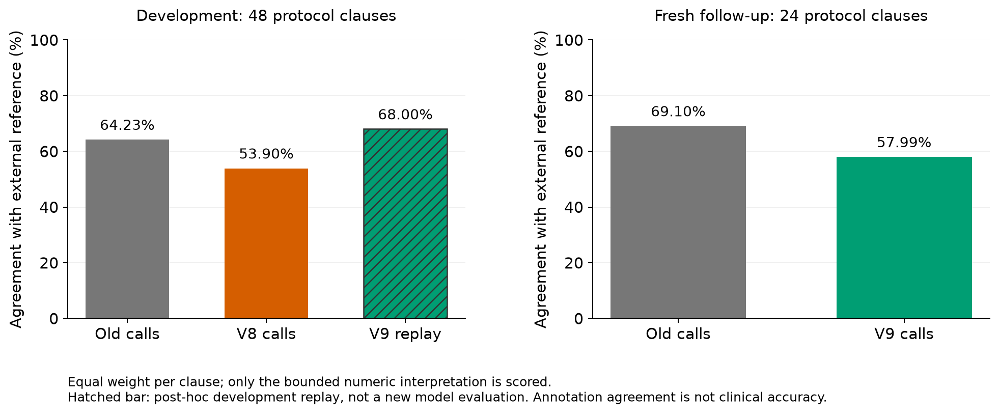

# 외부 Leaf 주석의 원문 준비 비교 — 완료, 후속 개발과 새 문구 평가 구분

외부 연구자가 배포한 참가 조건의 논리 표현과 실제 원문 준비를 비교한다. 참가 승인이나
전체 임상 의미의 정답 자료가 아니다. 원문을 지우거나 주석을 임의로 교정하지 않았다.

## 모델 실행 전에 정한 자료와 채점

2,060개 주석을 같은 시험 번호·포함/제외·원문으로 묶었다. 여러 주석의 구문이 다른
13문구는 임의의 주석을 정답으로 고르지 않고 제외했다. 프로젝트 `configs`·`data`에
등장하는 시험 번호 184개와 겹치는 시험도 제외 대상으로 뒀다. 주석에 보존된 미지원
시간·임상 문맥과 비수치 논리가 남는 표현은 전체를 보류했으며 일부를 잘라 정답으로 만들지 않았다.
읽은 1,999문구 중 완전히 변환한 수치 참고 표현 후보는 153개다. 이는 원문 전체가
동일하게 완전 주석됐다는 뜻이 아니다.

고정 난수 20261023으로 다중 사실 2, 범위 16, 단일 나이 15, 다른 단일 수치 15문구를
선택했다. 시험당 최대 한 문구, 총 **48개 서로 다른 시험·393개 합성 경계/누락 관측**이다.
범위는 양 끝·안·밖, 단일 비교는 경계·위·아래와 누락을 사용했다. 큰 복합 문구 하나는
모든 단독 경계를 포함한 뒤 고정 표집해 129관측으로 제한했다. 선택·참고식·원문·주석은
`cases.json`에 있다. 모델 결과를 보고 선택을 바꾸지 않는다.

일반 `BETWEEN` 주석은 끝점 포함을 명시하지 않아 네 개의 열린/닫힌 조합을 유지한다.
합성 환자값이 정해져 있어도 이 해석들이 다른 결론을 내면 **참고식 경계 모호성**으로
별도 보존하고 정오 채점에서 제외한다. 환자 정보가 부족한 `not_confirmed`와 다르다.
모든 해석의 결론이 같은 관측은 참고 일치 여부를 채점한다. 명시한 단일 비교의 경계는
채점하며, 원문에 포함이라고 써 있어도 외부 주석을 임의로 보충하지 않는다.

원문과 주석이 다른 것으로 보이는 두 복합 문구 및 수치 밖의 문맥이 남는 사례를 실행 전
`reference_notes`에 표시했다. 예를 들어 ALT **and** AST에 외부 주석은 `union`을
썼고, 다른 문구는 FEV1 외의 가래 배출 능력 조건이 주석에 없다. 이 경우 준비된 코드와
주석이 다르다는 것만으로 임상 오판을 선언하지 않는다. 원문은 그대로 모델에 제공한다.

외부 주석의 `equiv`는 명시한 동등 명칭/정의에서 숫자 표현을 찾는 데만 쓴다.
모델 출력의 개념명을 사후에 이 별칭으로 고쳐 주지 않는다. 합성 환자 개념·단위는
모델 실행 전에 주석으로 정했다. 단위 없는 일반 검사, Roman 범주와 미지원 비교는
보류한다. 무차원 `clin_score`에는 `score`라는 명시적 연구 표현을 사용한다.

## 비교와 현재 상태

기존 평평한 준비 `c25e002`와 원문 관계 가드 v8 `a3852b8`을 같은 모델·추론 설정에서
각각 48회 호출한다. 모델에는 원문·자료 위치만 주며 주석·참고식·합성 정답·별칭 목록을
주지 않는다. 기존 제안의 새 코드 재생과 새 제안의 기존 코드 재생으로 효과도 분리한다.
예측 상태의 명칭은 내부 판정 계약을 따른다. 논문에서는 외부 **참고 부분 해석과의 일치**로
보고하며 임상 적격 정확도로 부르지 않는다.

두 방법의 실제 96회 호출은 모두 정상 완료했다. 모델은 `gpt-5.6-sol`, medium,
SDK/runtime 0.147.0이었다. 361개는 참고 해석이 일치하는 관측, 그중 289개는 참고식에서
정리 가능하고 72개는 정보 부족이다. 32개는 참고 끝점 해석이 갈려 정오 채점에서 뺐다.
미시 관측 평균은 복합 두 문구의 145관측이 크게 좌우하므로 **48문구의 같은 가중치 평균**을
주로 보고한다. 파생 관측을 독립 환자로 세지 않는다.

| 실행 | 문구 평균 일치 | 관측 일치 /361 | 정리 일치 /289 | 정리 가능 중 보류 | 참고와 반대 확정/제외 | 참고 미정에서 결론 |
|---|---:|---:|---:|---:|---:|---:|
| 기존 실제 모델 | 64.23% | 175 | 103 | 183 | 0 /3 | 0 |
| 고정 v8 실제 모델 | 53.90% | 142 | 74 | 211 | 4 /0 | 4 |
| 기존 제안 → v8 코드 | 45.22% | 117 | 49 | 236 | 4 /0 | 4 |
| v8 제안 → 기존 코드 | 71.17% | 195 | 123 | 163 | 0 /3 | 0 |
| v8 제안 → 후속 v9 코드 | 68.00% | 179 | 107 | 179 | 0 /3 | 0 |
| 기존 제안 → 후속 v9 코드 | 48.21% | 122 | 50 | 239 | 0 /0 | 0 |

항상 보류하는 기준의 문구 평균은 22.17%, 정리 일치는 0이다. v8−기존의 문구 평균 차이는
-10.33%p, 고정 계층 안의 문구 단위 5,000회 부트스트랩 범위는 -21.18–0.09%p였다.
실행 전에 표시한 9문구를 뺀 39문구에서도 차이는 -11.11%p[-23.51,1.71]였다.
이를 임상 모집단 구간이나 우위·동등성·비열등성의 검정으로 부르지 않는다.

## 원인과 후속 v9

v8의 반대 확정 4개와 미정의 결론 4개는 모두 세미콜론으로 나눈 제외 문구 하나에서
발생했다. 외부 주석은 OR인데 코드가 bare 인접 원자를 AND로 정했고 제외 의미를
뒤집었다. 원문 자체가 연결을 명시하지 않으므로 주석을 따라 OR로 바꾸어 점수를 맞추지
않았다. v9은 이런 구두점·공백의 관계를 보류한다. 별개의 명시한 목록 항목은 포함과
제외 구역의 기존 의미를 유지한다.

반대로 `years old`, 소유격과 `yr/yrs`, 비교 연산자의 `or`가 불필요한 보류를 만들었다.
v9은 단순 표기·비교 문법을 확장하면서 범위의 미지원 시점 단어를 삭제하지 않도록 했다.
숫자 원자 안에 숨은 비수치 AND도 검증한다. 원문 의미가 부족하면 알려진 환자 근거를
유지한 채 원문 연결·시점을 묻는 질문을 남긴다. 이 질문을 추가 환자 검사로 자동 실행하지 않는다.
관련 입력·소스 가드·캐시·판정·실행 흐름 검사 **176개 통과**(0.57초). 실행 가능한
환자 질문이 없어도 원문 질문이 남으면 사람 확인으로 종료하며 최종 안내에 시험 원문·
담당자 확인 방법을 표시한다. 이 종료·표시는 고정 모델 비교 뒤의 실행 흐름 수정이다.

v9의 개발 재생 증가는 새 외부 검증이 아니다. 코드를 고정한 뒤 앞의 48개 시험과 겹치지
않는 [후속 24문구](../leaf-protocol-holdout-v1/)에서 실제 모델 48회를 추가 비교했다.
이 평가에서는 기존 69.10%, v9 57.99%로 우위가 재현되지 않았다. 모델·문구 단위 반복
추론을 하지 않았으므로 제안 생성의 변동과 코드 효과의 일반성을 확정하지 않는다.



## 참고식의 한계와 보존 파일

후속 재생에서 원문은 25–50 **years**인데 외부 주석은 `MONTH`인 문구를 발견했다.
초기 선택·합성 값·정답은 바꾸지 않았고 `reference_issues.json`에 **결과 후 발견**으로
기록했다. 원문에 맞춘 모델이 참고식과 달라질 수 있어 해당 제외 세 개를 실제 임상 오류로
승격하지 않는다. 사전 표시와 이 사례까지 뺀 38문구의 v8−기존 차이는 -10.53%p
[-23.25,2.41]였다. 제외 민감도도 의학적으로 검증한 정답 자료라는 뜻은 아니다.

입력·주석·끝점 모호성은 `cases.json`, 문구별 값은 `case_metrics.csv`, 계층별 값은
`stratum_metrics.csv`, 집계·불확실성은 `summary.json`이다. 실제 모델 제안과 결과는
`model_old_results.json`, `model_v8_results.json`에 보존했다. 두 실제 호출의 토큰 합계는
1,469,814이며 반복 가능한 일반 모델 비용 추정이 아니다. 원시와 재생은
`runs/leaf-model-20261023/`에 있다. 두 SDK 연결은 공용 실행기의 1.5GiB 메모리 상한과
동적 CPU 제한 안에서 완료했고 진행 중인 호출은 없다. 대규모 로컬 학습은 수행하지 않았다.

```powershell
python scripts/prepare_leaf_reference_corpus.py --download --source runs/leaf-source/upstream --output runs/leaf-prepared
python scripts/build_leaf_protocol_probe.py --source runs/leaf-prepared --output runs/leaf-probe
python scripts/run_natural_protocol_logic_research.py --mode model --cases runs/leaf-probe/cases.json --source-root runs/frozen-code --output runs/leaf-model --runtime-catalog runs/natural-logic-20261023/runtime-catalog.json
```

조건 텍스트·주석의 출처는 [UW Bio-NLP](https://github.com/uw-bionlp/leaf-corpora)의
고정 revision `461288aeba8b37fabd43bd7c55f0e1cb1bb10b9e`다. 2026-10-23 받았고
배포 저장소의 MIT 허가 문구를 `LICENSE.upstream`에 보존했다. 실제 환자 데이터는 없다.
자세한 출처·조건은 프로젝트 `DATA_SOURCES.md`의 Leaf 절을 따른다.

이 결과는 의학적 조언이 아닌 참고용입니다. 임상시험 참가 가능성은 해당 시험의 최신 기준과 전체 자료를 바탕으로 다시 확인해야 합니다.
