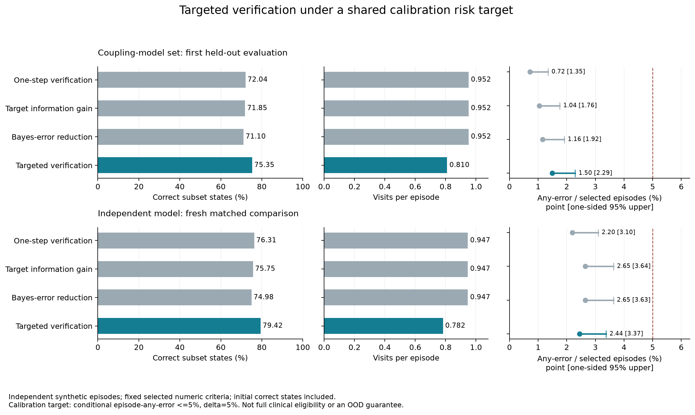

# 위험 교정과 선택적 재확인 — 핵심 방법 구현·합성 검증 완료

2026-10-23. 이전의 평가 확대를 넘어 실제 정보 획득 규칙을 바꾼 연구다. 높은
사전확률만으로 결론을 내지 않고 관측한 자료의 논리 증거가 있어야 한다. 그 증거의
오류 점수가 부족하면 재확인과 다른 사실 획득을 예산에서 함께 선택한다. 정책 전체를
별도 교정한 뒤 새 합성 환자를 평가했다. 전체 임상시험 적격이나 실제 환자 성능은 아니다.

## 원문과 방법의 관계

EC²/DRD의 결정 중심 정보 획득, EDDI의 목표 정보량, 선택적 분류의 보류·위험 구분,
LTT의 정확 이항 검정·Bonferroni와 알려진 결정 DAG를 사용했다. 새 일반 이론으로
주장하지 않는다. 원논문별 가져온 요소·가정·최근 방법과의 차이는
[연구 지식 문서](../../RESEARCH_KNOWLEDGE_BASE.md)의 핵심 방법 재연구 절에 있다.

구현은 `risk_aware_acquisition.py`, `selective_calibration.py`, `risk_aware_runtime.py`다.
실제 근거 연결은 날짜·출처·단위·검증·측정 범위·원문 확인과 근거 ID·질문을 유지한다.
기존 임상 `confirmed` 판정을 대체하지 않으며 모델 점수를 임상 위험이라고 표시하지 않는다.

## 자료와 교정

새 공개 시험 24건·수치 비교 58개다. 이전 256개 시험 번호를 제외하고 6검색 층에서
지원 수치 비교 수·조회 순서로 골랐다. 단위 환산과 남은 시점·임상 문맥을 보존했다.
`data/paper_risk_method_v1/protocol_subsets.json`이 고정 자료다. 수치 비교 부분의
참고식이며 독립 임상가의 전체 프로토콜 정답이 아니다.

개발은 이전 개발 시험의 12에피소드에서 했다. 첫 비교는 17개 정책/임계값, 새
교정 1,200·평가 1,200에피소드다. 환자마다 층·가림·공유 조건을 독립 추출했다.
정책별로 같은 잠재 반환을 사용하며, 참값·미래 보고는 선택기에 주지 않았다.
확인 최대 3회·추가 방문 최대 1회, 충분한 반환 .70/.95, 내용 오류 .05다.

교정 목표는 새 결론을 하나 이상 낸 환자에서 그중 하나라도 잘못됐을 확률 .05다.
정확 이항 검정과 전체 유한 가족의 Bonferroni .05를 사용했다. 여러 시험/가림을
독립 환자로 세지 않으며 질문·정지까지 정책 전체를 교정했다. 같은 IID 혼합에서만
보장하고 임상·분포 변화나 각 질환의 조건부 보장으로 옮기지 않는다.

## 첫 결과와 원인 분리

첫 평가에서 같은 공유 모형 집합·판정기의 한 단계/새 방법은 올바른 상태 3,458/3,617,
방문 1,142/972회였다. 상태 분모는 4,800, 방문은 1,200환자 합계다. 차이는
+3.31%p[2.48,4.17], 방문은 환자당 -.142[-.161,-.123]였다.
오판 환자는 7/972→15/1,003명으로 증가했다. 실제 오류 감소를 주장하지 않는다.

독립 모형 변형이 3,780개·방문 956회로 더 높았다. 공유 모형 집합의 추가 효과가
입증되지 않아 핵심 향상으로 삼지 않았다. 그 결과를 본 뒤, 모형·판정기를 모든
비교군에서 동일하게 맞추고 방법·τ=.03을 유지한 새 교정/평가를 추가했다.
새 난수 45002/56002이고 네 정책 모두 새 교정을 통과했다. 첫 교정 보장은 재사용하지 않았다.

## 모형을 동일하게 맞춘 새 환자의 결과

| 방법 | 올바른 상태 /4,800 | 방문 /1,200 | 오판 환자 /새 결론 환자 | 오류 % [단측 95% 상한] |
|---|---:|---:|---:|---:|
| 한 단계 | 3,663 | 1,136 | 23 /1,046 | 2.20 [3.10] |
| 목표 정보량 | 3,636 | 1,136 | 27 /1,019 | 2.65 [3.64] |
| Bayes 오류 감소 | 3,599 | 1,136 | 27 /1,020 | 2.65 [3.63] |
| 선택적 재확인 | 3,812 | 939 | 26 /1,064 | 2.44 [3.37] |

한 단계 대비 상태 일치 +3.10%p[2.29,3.90], 실제 방문 -197회=17.34% 감소다.
시도 합계는 2,957→3,022회로 늘었다. 더 적은 총 행동이나 실제 시간/비용 절감을
주장하지 않는다. 잘못된 확정/제외는 11/21→14/24개이며, 위험 목표의 같음이
오류 동등성·비열등성의 증거는 아니다. 첫 후보 기회 690개 중 466→516개를 확인했다.



## 실패 범위와 재현

첫 고정 정책을 값 분포 변화·오류 .15의 600에피소드에 적용하면 모형 집합/독립
변형의 선택적 오류는 49/470=10.43%, 58/519=11.18%였다. 둘 다 목표를 넘었다.
구성요소 제거·검색 층·공유 조건과 모든 비교는 `analysis.json`, 새 비교는
`matched_analysis.json`에 있다. 모형·교정·평가 요약, 집계 CSV와 PNG/SVG도 보존했다.
초기 기록을 참으로 두었으며 원문은 수치 부분만 표현하고 유한 격자를 사용했다.

새 코드와 실제 근거 연결 21개·관련 기존 76개, 총 97개 검사가 통과했다(0.54초).
전체 패키지 검사가 아니다. 서버 N100의 실행마다 MemoryMax=2G·CPUQuota=100%를
적용했고 실제 계산은 종료 0이다. 첫 기동의 Python 환경·SSH 종료에 따른 사용자
서비스 중단은 수정했으며 완료 실험과 구분한다. 현재 진행 중인 계산은 없다.
원시는 `runs/risk-method-20261023/`이며 실제 환자·모델 추론 호출은 없다.

```powershell
python scripts/build_risk_acquisition_benchmark.py --source runs/risk-trial-sources-20261023
python scripts/run_risk_aware_acquisition.py --phase calibration --episodes 1200 --output runs/risk/calibration
python scripts/run_risk_aware_acquisition.py --phase test --episodes 1200 --selection runs/risk/calibration/summary.json --output runs/risk/test
python scripts/run_risk_aware_acquisition.py --phase stress --episodes 600 --selection runs/risk/calibration/summary.json --output runs/risk/stress
python scripts/run_risk_aware_acquisition.py --phase calibration --episodes 1200 --independent-belief --seed 45002 --cutoffs .03 --methods risk_myopic risk_entropy risk_bayes risk_targeted --output runs/risk/matched/calibration
python scripts/run_risk_aware_acquisition.py --phase test --episodes 1200 --independent-belief --seed 56002 --cutoffs .03 --methods risk_myopic risk_entropy risk_bayes risk_targeted --selection runs/risk/matched/calibration/summary.json --output runs/risk/matched/test
python scripts/analyze_risk_aware_acquisition.py --root runs/risk --output runs/risk/analysis
python scripts/analyze_risk_aware_acquisition.py --root runs/risk/matched --output runs/risk/matched/analysis
python scripts/plot_risk_aware_acquisition.py --root runs/risk --output docs/internal/results/risk-aware-acquisition-v1
```

큰 재현 계산은 서버 작업의 자원 한도 안에서 실행한다. 데이터·코드는 공개하고,
모든 환자·자료원·오류·경로 품질은 합성이다. 새 원문 준비나 최신 신경망 AFA 전체의
우위를 검증한 결과로 부르지 않는다.

이 결과는 의학적 조언이 아닌 참고용입니다. 임상시험 참가 가능성은 해당 시험의 최신 기준과 전체 자료를 바탕으로 다시 확인해야 합니다.
